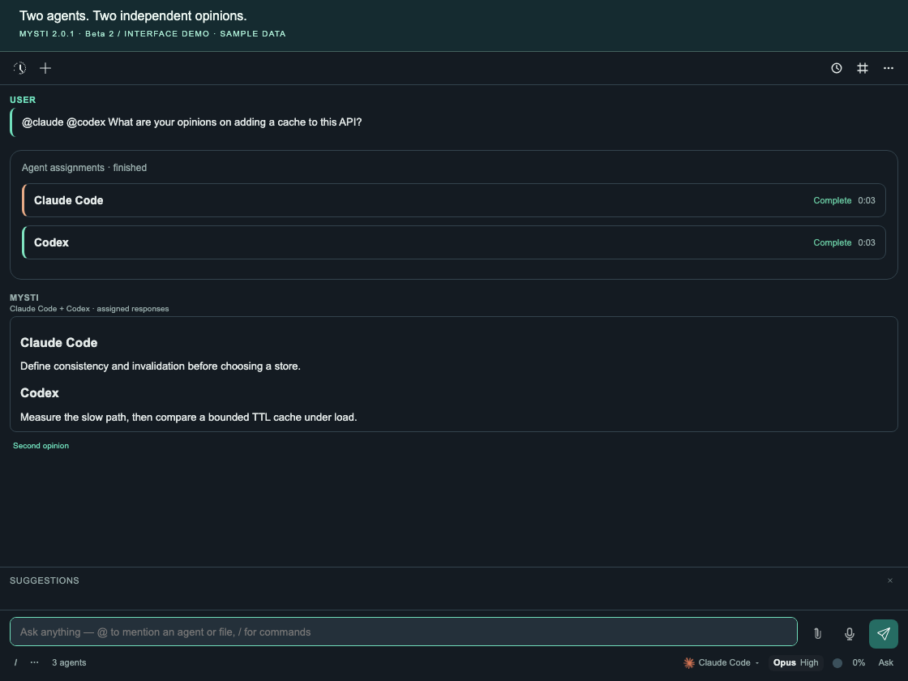
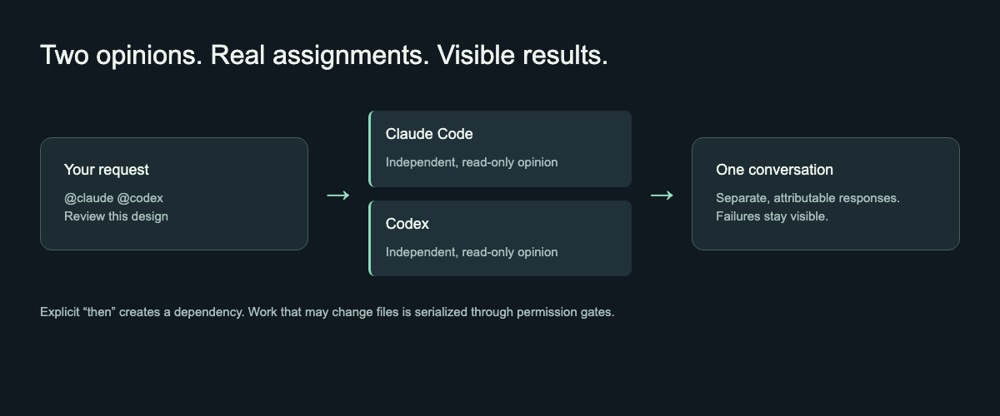

<p align="center">
  <a href="https://marketplace.visualstudio.com/items?itemName=DeepMyst.mysti">Install Mysti</a> ·
  <a href="docs/GETTING-STARTED.md">Get started</a> ·
  <a href="docs/DEMO_GALLERY.md">Watch the demos</a> ·
  <a href="docs/releases/2.0.1-beta.2/RELEASE-NOTES.md">Beta 2 release notes</a> ·
  <a href="CONTRIBUTING.md">Contribute</a>
</p>


# Mysti

**2.0.1 · Beta 2**

**An open-source coding workspace that brings your agents together inside VS Code.**

Ask Claude Code and Codex for independent opinions. Give a specialist a specific task. Hand completed work to another agent for review. Keep their responses, context, permissions, and progress in one conversation.

Mysti connects the coding tools you choose—CLI agents, local model servers, and the DeepMyst-powered Mysti coordinator. Use one agent when that's enough; bring in more when another perspective helps.

[](https://github.com/DeepMyst/Mysti/actions/workflows/ci.yml)
[](https://marketplace.visualstudio.com/items?itemName=DeepMyst.mysti)
[](LICENSE)

> **Beta release.** Version 2.0.1 focuses on reliability, recovery, and clearer controls. Download the [Beta 2 VSIX](https://github.com/DeepMyst/Mysti/releases/tag/v2.0.1-beta.2), or check the Marketplace badge for its currently published version. See [verified status and the path to stable](docs/PRODUCTION_READINESS.md); full production acceptance is still in progress.

**16 provider adapters + the Mysti coordinator · Parallel opinions · Cross-agent handoffs · Connected tools · Proactive context**

## See it work

[**Explore the feature recordings →**](docs/DEMO_GALLERY.md)

Short, focused walkthroughs show the shipped interface with readable captions and a consistent layout. Pick the workflow you want to see:

| Start here | Then explore |
| --- | --- |
| **Set up your workspace** — onboarding, provider selection, model controls | **Give agents context** — files, attachments, access modes |
| **Work with several agents** — independent opinions, ordered handoffs, Brainstorm | **Stay in control** — approvals, Stop, conversation history, fork and rewind |
| **Build visually** — Canvas and Visual Test | **Connect your workflow** — tools, Proactive, settings |

The gallery identifies which scenes use deterministic sample responses. These recordings demonstrate the interface; native-provider acceptance and remaining gaps are tracked separately in the [readiness report](docs/PRODUCTION_READINESS.md).

### Independent opinions, one conversation

```text
@claude @codex What are your opinions on adding a cache to this API?
```

Each named agent receives its own assignment and has a separately attributed answer. Independent read-only work can run concurrently. Failed participants remain visible.

[](docs/releases/2.0.1-beta.2/media/agent-opinions.mp4)

### A clear handoff when order matters

```text
@claude Design a retry policy, then @codex review it for edge cases
```

The reviewer receives the first agent's completed result. A failed prerequisite blocks the dependent step. Work that may edit the shared workspace runs serially.


These examples use deterministic sample responses in the shipped interface. [See the refreshed Beta 2 gallery](docs/DEMO_GALLERY.md) · [Assignment and workflow guide](docs/MENTIONS.md).

## More ways to move the work forward

| Feature | Why it matters | Explore |
| --- | --- | --- |
| **Brainstorm** | Let two agents analyze, debate or challenge a proposal, then synthesize a response. | [Discussion strategies](docs/BRAINSTORM.md) |
| **Canvas + Visual Test** | Iterate on visual artifacts and inspect a running app alongside the code. | [Visual workflows](docs/DEMO_GALLERY.md#design-and-inspect-visually) |
| **Personas, skills and roles** | Reuse project guidance and specialist perspectives instead of repeating instructions. | [Team practices](docs/PERSONAS-AND-SKILLS.md) |
| **Checkpoints + visible approvals** | Inspect requested actions and recover supported local changes as you iterate. Checkpoints do not undo external actions. | [Access and lifecycle](docs/FEATURES.md#permission-system) |
| **Dictation + context tools** | Speak a draft, mention files, or attach diagnostics and Git context before sending. | [Composer and context](docs/FEATURES.md#chat-interface) |

## One workspace, several ways to work

| When you need… | Use… | What happens |
| --- | --- | --- |
| A direct answer or implementation | A selected provider, or `@claude` / `@codex` | The named agent handles the request with your access settings. |
| Independent perspectives | `@claude @codex` with a question or review request | Read-only assignments run concurrently; results remain separately attributed. |
| An ordered handoff | `@claude Write the parser, then @codex review it` | The reviewer receives the completed result as reference material. A failed dependency blocks the handoff. |
| A defined perspective | `@claude:critic @codex:reviewer` | Catalog roles shape each response and restrict its access. |
| A structured discussion | Brainstorm | Choose a team and discussion strategy, then follow its rounds and synthesis. |
| A coordinating agent | Mysti | A DeepMyst-backed coordinator can answer, use configured tools, and delegate through permission gates. |
| Visual iteration | Canvas and Visual Test | Work with visual artifacts and inspect a running app; browser setup may be required. |
| Project-specific practices | Personas, skills, and roles | Reuse your team's guidance with explicit trust and access boundaries. |



Parallelism follows the work: independent advisory requests may overlap; writers share a workspace and run serially. Use **then** for an explicit dependency. [Assignment syntax and troubleshooting](docs/MENTIONS.md).

## Get started

1. **Install Mysti** from the [VS Code Marketplace](https://marketplace.visualstudio.com/items?itemName=DeepMyst.mysti), or install the reviewed beta VSIX with **Extensions → Install from VSIX**. The [GitHub release](https://github.com/DeepMyst/Mysti/releases/tag/v2.0.1-beta.2) provides the versioned Beta 2 VSIX; registry publication is tracked separately.
2. **Open a trusted local workspace.** Mysti supports VS Code 1.86 or newer on Windows, macOS, and Linux. Native voice support and provider CLIs have their own host requirements.
3. **Open Mysti and choose your agent.** The setup screen checks installation and authentication and provides the supported install, upgrade, or sign-in action. Mysti itself uses your DeepMyst account; CLI agents use their own credentials.
4. **Start with a small task.** Try `@claude Explain the main entry point`, then add `@codex` for a second opinion when both are configured.

You only need **one** configured agent to begin. Provider subscriptions, API access, usage charges, and supported models vary. [Getting started](docs/GETTING-STARTED.md) · [Provider setup](docs/PROVIDERS.md).

## Bring your preferred agents

| Provider family | Available adapters |
| --- | --- |
| Coding agents | Claude Code, OpenAI Codex, Google Gemini CLI, GitHub Copilot CLI, Cline, Cursor |
| Additional coding tools | OpenClaw, OpenCode, Qwen Code, Hermes, Continue, Kimi Code |
| Local / API endpoints | Ollama, LocalAI, OpenRouter, MiniMax |
| Mysti coordinator | DeepMyst account, with optional configured local execution and delegation |

The UI follows each adapter's capabilities. Model availability, effort, Ultracode, attachments, native approvals, and authentication are provider-specific. An adapter being included is not a claim that every provider/version/account combination has been live-tested. [Compatibility and setup](docs/PROVIDERS.md).

## Your context and your controls

- **Context where it belongs:** mention workspace files, inspect diagnostics with `@problems`, or add a Git summary with `@git`.
- **Visible authority:** read-only and approval modes, agent-specific tool activity, and cancellation across active assignments.
- **Continuity:** conversation history, context compaction, and workspace checkpoints for supported local changes.
- **Explicit connections:** choose the DeepMyst tools and sources used by connected features. Cloud responsibilities continue on the backend; local Git watches need the editor running.

Provider requests transmit the prompt and supplied context to the configured provider. DeepMyst features use your connected account. Telemetry follows VS Code's telemetry setting; see the [security policy](.github/SECURITY.md) and feature-specific guides. A local checkpoint cannot undo an external action.

## Explore the documentation

| Guide | What it covers |
| --- | --- |
| [Start here](docs/GETTING-STARTED.md) | Install, configure, send your first task, troubleshoot |
| [Agent assignments](docs/MENTIONS.md) | Tags, roles, parallel reviews, dependent handoffs |
| [Providers](docs/PROVIDERS.md) | Installation, authentication, models, capability differences |
| [Feature guide](docs/FEATURES.md) | Chat, menus, dictation, Canvas, permissions and more |
| [Brainstorm](docs/BRAINSTORM.md) | Team discussion and synthesis |
| [Personas and skills](docs/PERSONAS-AND-SKILLS.md) | Reusable project practices |
| [Proactive](docs/PROACTIVE.md) | Responsibilities, evidence, notification and coverage limits |
| [Architecture](docs/ARCHITECTURE.md) | Host, webview, routing and provider boundaries |
| [Release notes](docs/releases/2.0.1-beta.2/RELEASE-NOTES.md) | What's new, migration, known limitations |
| [Production readiness](docs/PRODUCTION_READINESS.md) | Verified status, remaining work, portable checklist for every release |
| [Demo gallery](docs/DEMO_GALLERY.md) | Feature recordings, coverage, capture instructions |
| [Contributing](CONTRIBUTING.md) | Development, meaningful tests, demos and release work |

**Translations:** [العربية](README.ar.md) · [中文](README.zh-CN.md) · [日本語](README.ja.md) · [한국어](README.ko.md) · [Español](README.es.md) · [Português](README.pt-BR.md) · [Deutsch](README.de.md) · [Français](README.fr.md) · [Türkçe](README.tr.md) · [Русский](README.ru.md). Community translations may describe an earlier release; this README is the current Beta 2 reference.

## Build with us

Mysti is Apache-2.0 licensed. Useful contributions include reproducible routing bugs, native-provider compatibility checks, accessible UI improvements, and tested documentation corrections.

```sh
npm ci
npm run typecheck
npm test
npm run watch
```

Use the Node version in `.nvmrc`; press **F5** to launch the extension development host. See [CONTRIBUTING.md](CONTRIBUTING.md) for provider contracts, browser tests, and contribution expectations.

[Report a bug](https://github.com/DeepMyst/Mysti/issues/new/choose) · [Discuss an idea](https://github.com/DeepMyst/Mysti/issues) · [View the roadmap](plans/README.md)

## Contributors

Thanks to everyone who has helped make Mysti better!

<a href="https://github.com/BahaAbuNojaim"></a>
<a href="https://github.com/MostlyKIGuess"></a>
<a href="https://github.com/a-programmers-programmer"></a>
<a href="https://github.com/patrick-fu"></a>
<a href="https://github.com/3em0"></a>

Want to join them? Check out the [contribution guide](CONTRIBUTING.md) section below.

---

## License

[Apache License 2.0](LICENSE). Built by [DeepMyst](https://www.deepmyst.com/mysti) and the Mysti community. Provider names and trademarks belong to their respective owners.
