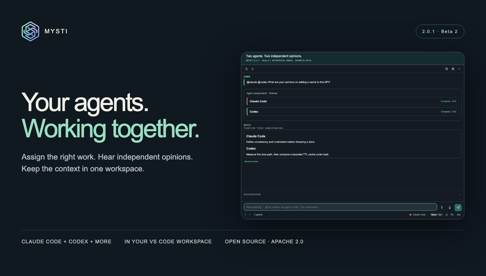
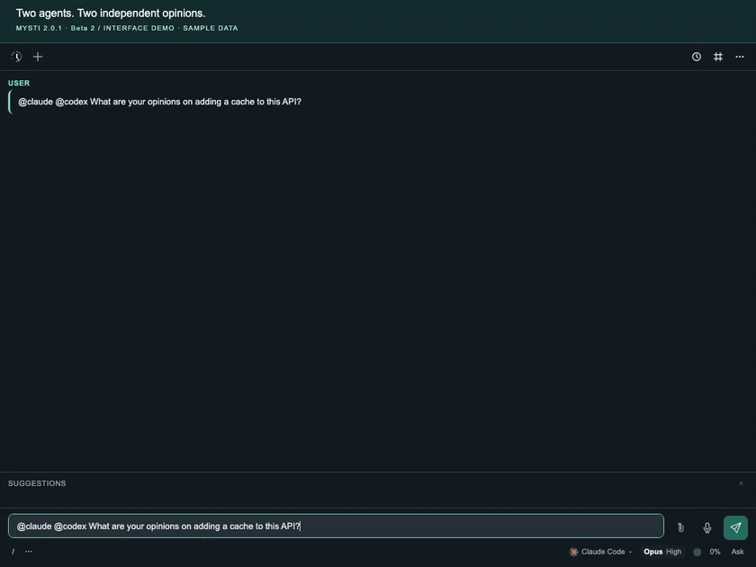
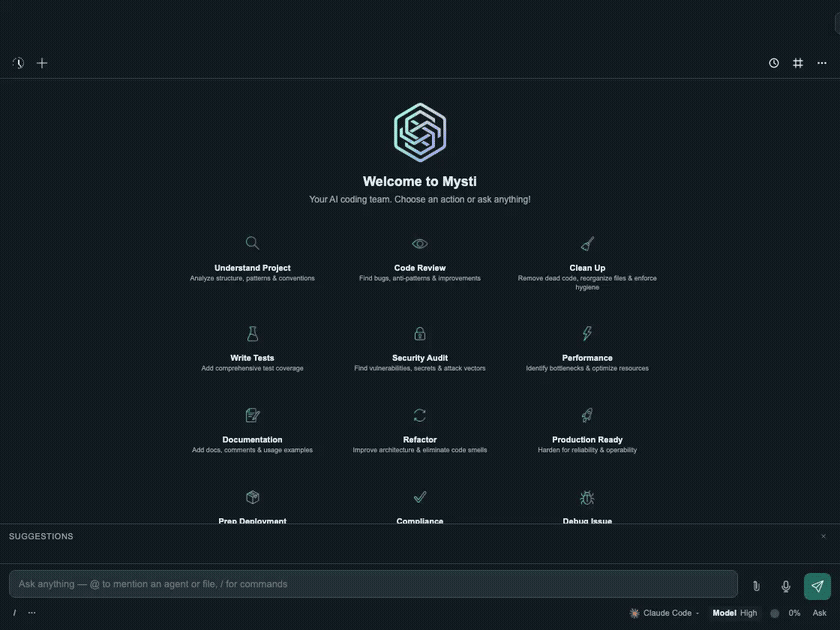
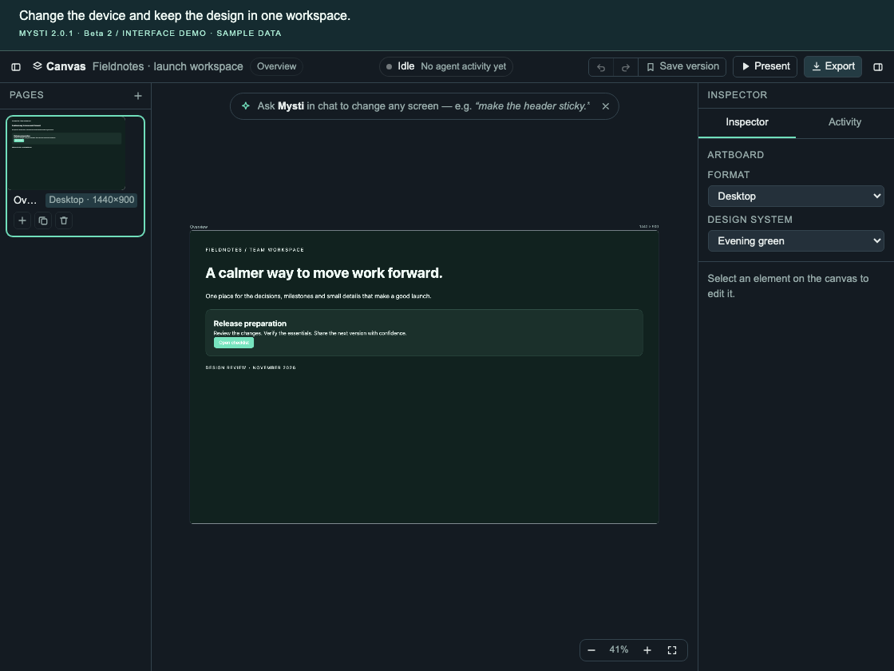

<p align="center">
  <a href="https://github.com/DeepMyst/Mysti/releases/download/v2.0.1-beta.2/mysti-2.0.1-beta.2.vsix"><strong>Download Beta 2</strong></a> ·
  <a href="https://marketplace.visualstudio.com/items?itemName=DeepMyst.mysti">VS Code Marketplace</a> ·
  <a href="#get-started">Quick start</a> ·
  <a href="docs/DEMO_GALLERY.md">Watch the demos</a> ·
  <a href="#documentation">Documentation</a>
</p>



# Mysti

### Your coding agents. One shared workflow.

**Bring Claude Code, Codex and other coding agents together inside VS Code.** Ask for independent opinions, hand completed work to another agent, and keep the context, progress and answers in one conversation.

Start with one agent. Add a reviewer when the work needs another perspective. Use Canvas for visual iteration and Brainstorm for decisions that deserve a deeper discussion.

**[Download the tested Beta 2 VSIX →](https://github.com/DeepMyst/Mysti/releases/download/v2.0.1-beta.2/mysti-2.0.1-beta.2.vsix)** · [Install from Marketplace](https://marketplace.visualstudio.com/items?itemName=DeepMyst.mysti) · [See what's new](CHANGELOG.md)

[](https://github.com/DeepMyst/Mysti/actions/workflows/ci.yml?query=branch%3Amain)
[](https://marketplace.visualstudio.com/items?itemName=DeepMyst.mysti)
[](docs/GETTING-STARTED.md)
[](LICENSE)

> **Current GitHub release: 2.0.1 · Beta 2.** For the Marketplace version, [check the listing](https://marketplace.visualstudio.com/items?itemName=DeepMyst.mysti). Mysti remains beta; review the [verified status and remaining work](docs/PRODUCTION_READINESS.md) when choosing it for your project.

[Why Mysti](#why-mysti) · [See it work](#see-it-work) · [Get started](#get-started) · [Workflows](#put-your-agents-to-work) · [Features](#more-than-a-chat-window) · [Providers](#bring-your-preferred-agents) · [FAQ](#frequently-asked-questions)

## Why Mysti

A coding task often needs more than one kind of thinking: understand the code, propose a change, challenge the approach, then review the result. Mysti gives those steps a place to work together.

- **Compare independent answers.** Address several agents in one message and see who said what, with separate progress and results.
- **Make the handoff explicit.** Ask one agent to finish a task, **then** have another review it with the completed result as context.
- **Bring the code into the conversation.** Use file mentions, selected code, diagnostics and Git context instead of repeatedly copying the same material.
- **Keep your preferred tools.** Choose among 16 provider adapters, or use the Mysti coordinator. Each provider keeps its own model, account and capability settings.
- **Follow the work in your editor.** Move between conversation history, agent activity, visual artifacts and relevant connected context.

## See it work

**Watch the 3-minute, 19-second tour:** setup, provider choice, agent handoffs, Brainstorm, access controls, history, Canvas and connected tools.

https://github.com/user-attachments/assets/edb4beb3-08e1-4790-be3a-6550b2afd227

[Explore all 15 feature demos →](docs/DEMO_GALLERY.md) · [Tour chapters](docs/releases/2.0.1-beta.2/media/CHAPTERS.md) · [Download the video kit](https://github.com/DeepMyst/Mysti/releases/download/v2.0.1-beta.2/mysti-2.0.1-beta.2-feature-demos.zip)

*The tour uses clearly labelled sample data in the shipped interface. Provider accounts and live-service behavior are documented separately.*

## Get started

You need **VS Code 1.86 or newer**, a trusted local workspace on Windows, macOS or Linux, and **one configured provider**. A second provider is optional for everyday chat and needed for workflows that involve two agents.

### 1. Install Mysti

For the reviewed **2.0.1 Beta 2** build, [download the VSIX](https://github.com/DeepMyst/Mysti/releases/download/v2.0.1-beta.2/mysti-2.0.1-beta.2.vsix), open the Command Palette, choose **Extensions: Install from VSIX**, and select the downloaded file. Reload VS Code after updating an existing installation.

You can also install the version currently available on the [VS Code Marketplace](https://marketplace.visualstudio.com/items?itemName=DeepMyst.mysti). The [GitHub release](https://github.com/DeepMyst/Mysti/releases/tag/v2.0.1-beta.2) includes the exact beta package, checksums and validation record.

### 2. Connect one agent

Open **Mysti: Open Chat** from the Command Palette or click Mysti in the Activity Bar. Choose a provider and follow its setup card to check installation, sign-in and model availability.

Use your existing Claude Code, Codex or another supported provider account. For local models, configure Ollama or LocalAI. The Mysti coordinator supports DeepMyst sign-in or a configured direct OpenRouter key. [Provider setup →](docs/PROVIDERS.md)

### 3. Give it a focused first task

Add a file or selected code through **Add to Mysti Context**, then ask:

```text
Explain how this code works and identify the most useful test to add next.
```

Once Claude Code and Codex are configured, try an independent review:

```text
@claude @codex Review this code for edge cases. Explain your findings separately.
```

Choose an access mode supported by the selected provider, inspect its response and requested actions, then iterate. You can use Mysti in the sidebar or open a larger chat tab.

**[Full setup guide](docs/GETTING-STARTED.md)** · [Troubleshooting](docs/GETTING-STARTED.md#if-something-goes-wrong) · [Provider compatibility](docs/PROVIDERS.md#permissions-and-compatibility)

## Put your agents to work

### Get two independent perspectives

```text
@claude @codex What are your opinions on adding a cache to this API?
```

Each named agent receives the question and has its own answer. Independent read-only assignments can run concurrently. A failed or unavailable participant stays visible, so you can assess the results you actually received.



### Design, implement, then review

```text
@claude Design a retry policy, then @codex review it for edge cases
```

The second agent waits for the first and receives its completed result. A failed prerequisite blocks the dependent step. Use the same pattern for implementation followed by review; work that may write to the shared workspace runs serially.



*Sample-data demonstration. [See the captioned walkthrough](docs/DEMO_GALLERY.md#bring-agents-together).*

### Give each agent a focused role

```text
@claude:critic @codex:reviewer Assess this proposal
```

Catalog roles shape each agent's perspective and access. You can also assign separate questions in one message:

```text
@claude review the authentication design; @codex assess performance
```

### Bring the right context

```text
@src/api.ts @claude @codex Review this API
@problems @claude Explain these diagnostics
@git @codex Review the current changes
```

Use the file picker to select the intended file, or add it through Context. For explicit multi-agent assignments, use **Context or file mentions**; composer attachments are not currently forwarded to those collaborators.

### Explore a decision with Brainstorm

Choose two configured agents and a discussion strategy: **Quick**, **Debate**, **Red Team**, **Perspectives** or **Delphi**. Follow their analyses, discussion and final synthesis when a question benefits from more than separate answers.

[Agent assignment guide](docs/MENTIONS.md) · [Brainstorm strategies](docs/BRAINSTORM.md) · [Personas, skills and roles](docs/PERSONAS-AND-SKILLS.md)

## More than a chat window

| Your workflow | What Mysti brings |
| --- | --- |
| **Understand and change code** | Streaming responses, provider-specific model and effort controls, file context, diagnostics and Git summaries. |
| **Get a second opinion** | Send the original question to another agent from a completed answer, or ask several agents explicitly. |
| **Make a decision** | Brainstorm strategies for independent analysis, debate, challenge and synthesis. |
| **Explore a visual design** | Canvas artifacts with live previews, device formats and theme controls alongside your conversation. |
| **Inspect a running app** | Visual Test brings screenshots, findings and reports together. Browser setup may be required. |
| **Return to earlier work** | Conversation history, forks, context compaction and checkpoints for supported local code changes. |
| **Apply your team's practices** | Built-in and custom personas, reusable skills and catalog roles for the task at hand. |
| **Speak a draft** | Dictation through supported VS Code voice commands; review the text before sending. |
| **Work with connected tools** | Configure supported apps and tools through your DeepMyst account and choose the connections available to the work. |
| **Notice relevant changes** | Proactive watches for local Git activity or supported connected GitHub/Slack sources, with source-linked evidence to review. |

### Visual work, close to the code

Use **Canvas** to explore an artifact's presentation and **Visual Test** to inspect a running application. They are separate workflows: a rendered design and a browser report answer different questions.

[](docs/DEMO_GALLERY.md#design-and-inspect-visually)

[Watch Canvas and Visual Test](docs/DEMO_GALLERY.md#design-and-inspect-visually) · [Full feature guide](docs/FEATURES.md)

### Relevant context before you start

The **Proactive inbox** lets you review observed repository changes and related connected-source evidence before starting a task. Local Git watches run while the editor is open; configured cloud responsibilities run through DeepMyst. Monitoring is read-only and does not authorize an agent to act. [Set up Proactive →](docs/PROACTIVE.md)

## Bring your preferred agents

Mysti includes **16 provider adapters plus the Mysti coordinator**. Start with the tools you already use, then configure others when a task calls for them.

| Provider family | Available adapters |
| --- | --- |
| Coding agents | Claude Code · OpenAI Codex · Google Gemini CLI · GitHub Copilot CLI · Cline · Cursor |
| Additional coding tools | OpenClaw · OpenCode · Qwen Code · Hermes · Continue · Kimi Code |
| Local and API endpoints | Ollama · LocalAI · OpenRouter · MiniMax |
| Mysti coordinator | DeepMyst gateway or a configured direct OpenRouter key, with supported tools and agent delegation |

Each adapter has its own setup and capabilities. Models, subscriptions, attachments, approvals and available controls depend on the selected provider and account. Ollama and LocalAI display tool proposals rather than executing them through those adapters. Inclusion in the catalog does not mean every provider/version/account combination has completed native acceptance testing.

**[Choose and configure a provider →](docs/PROVIDERS.md)**

## Context, permissions and recovery

- **Choose what you share.** Add workspace files, selected text, diagnostics, Git context or supported attachments. Each chat panel keeps its own context.
- **Inspect the requested work.** Follow attributed tool activity and use the access and approval modes supported by your provider. Agent tags do not grant extra authority.
- **Stop and refocus.** Cancel an active request, inspect its outcome and send a focused follow-up. Stop is not an undo operation for completed external actions.
- **Return to an earlier point.** Branch a conversation or use checkpoints to recover supported local code changes. Keep normal version control and backups for your project.

Prompts and supplied context go to the configured provider. Connected DeepMyst features use your account and selected connections. Mysti's telemetry integrates with VS Code's telemetry setting; local-model chat does not make every connected feature offline. See the [provider approval contracts](docs/NATIVE_APPROVAL.md), [feature guide](docs/FEATURES.md) and [security policy](.github/SECURITY.md).

## What's new in Beta 2

This release focuses on reliable context, cancellation and recovery:

- **OpenCode Stop cleanup:** owned shell descendants in separate process groups are included in cancellation, with bounded native macOS verification.
- **Conversation ownership:** stronger handling for drafts, attachments, queued messages, history and second opinions.
- **Windows CLI updates:** selected npm-backed installations are checked without shell interpolation.
- **Safer entry points:** prompt deep links are reviewed before insertion, shared imports default to declining, and sensitive Git configuration is excluded from coordinator reads.
- **A reviewable release:** a qualified VSIX, checksums, test evidence, 15 feature recordings and a portable release checklist.

[Release notes](docs/releases/2.0.1-beta.2/RELEASE-NOTES.md) · [Changelog](CHANGELOG.md) · [Validation](docs/releases/2.0.1-beta.2/VALIDATION.md) · [Remaining work toward stable](docs/PRODUCTION_READINESS.md)

## Frequently asked questions

<details>
<summary><strong>Do I need multiple agents or a DeepMyst account?</strong></summary>

One configured provider is enough for regular chat. Workflows involving two agents need both configured. Direct CLI and endpoint providers use their own credentials; DeepMyst sign-in is used for the gateway and connected DeepMyst features. The Mysti coordinator also supports a configured direct OpenRouter key.

</details>

<details>
<summary><strong>Does installing Mysti include model access or credits?</strong></summary>

No. Mysti is an Apache-2.0 open-source extension. Provider subscriptions, model access, API charges and any DeepMyst account requirements are separate. Each participating provider may incur its own usage when you run a multi-agent task.

</details>

<details>
<summary><strong>Can I use local models?</strong></summary>

Yes. Configure Ollama or LocalAI with a running server and an available model. These adapters support chat and display proposed tool calls; they do not execute those proposals. Other configured providers and connected features may use remote services.

</details>

<details>
<summary><strong>Will agents edit the same files at the same time?</strong></summary>

Independent read-only assignments can overlap. Work that may change the shared workspace runs serially. An explicit <code>then</code> makes the next assignment wait for a successful result from the preceding one. This is an in-conversation workflow, with the provider's applicable access controls.

</details>

<details>
<summary><strong>Why is an agent, model or permission mode unavailable?</strong></summary>

Installation, authentication, model entitlement and transport capability are separate requirements. Check the provider's setup card and any upgrade guidance. Some adapters cannot enforce every access mode. Use the [compatibility guide](docs/PROVIDERS.md#permissions-and-compatibility) to choose a supported combination.

</details>

<details>
<summary><strong>Is this production-ready?</strong></summary>

Mysti 2.0.1 remains beta. The release includes automated source, browser, runtime, package and editor validation; full native provider/account coverage, broader recovery and upgrade acceptance, and long-duration testing remain incomplete. The [readiness report](docs/PRODUCTION_READINESS.md) lists the evidence, open work and reusable release gates.

</details>

## Documentation

| Start building | Go deeper |
| --- | --- |
| [Getting started](docs/GETTING-STARTED.md) — installation, first task and troubleshooting | [Feature guide](docs/FEATURES.md) — chat, context, controls and settings |
| [Provider setup](docs/PROVIDERS.md) — accounts, models and capability differences | [Personas and skills](docs/PERSONAS-AND-SKILLS.md) — reusable practices and custom guidance |
| [Agent assignments](docs/MENTIONS.md) — tags, roles, parallel opinions and handoffs | [Proactive](docs/PROACTIVE.md) — watches, evidence and coverage |
| [Brainstorm](docs/BRAINSTORM.md) — discussion strategies and synthesis | [Architecture](docs/ARCHITECTURE.md) — host, webview, routing and providers |
| [Demo gallery](docs/DEMO_GALLERY.md) — 15 focused feature walkthroughs | [Production readiness](docs/PRODUCTION_READINESS.md) — status and release checklist |

**Translations:** [العربية](README.ar.md) · [中文](README.zh-CN.md) · [日本語](README.ja.md) · [한국어](README.ko.md) · [Español](README.es.md) · [Português](README.pt-BR.md) · [Deutsch](README.de.md) · [Français](README.fr.md) · [Türkçe](README.tr.md) · [Русский](README.ru.md). Community translations may describe an earlier release; this README is the current Beta 2 reference.

## Build with us

Useful contributions include reproducible bugs, native-provider compatibility checks, accessible UI improvements and tested documentation corrections. Include your Mysti, VS Code, OS and provider versions in a bug report, with private context removed.

Use the Node version in `.nvmrc`, then:

```sh
npm ci
npm run typecheck
npm test
npm run watch
```

Press **F5** to launch the extension development host. See [CONTRIBUTING.md](CONTRIBUTING.md) for the development workflow, browser checks and provider contracts.

[Report a bug](https://github.com/DeepMyst/Mysti/issues/new/choose) · [Discuss an idea](https://github.com/DeepMyst/Mysti/issues) · [Explore the roadmap](plans/README.md)

## Contributors

Thanks to everyone who has helped make Mysti better!

<a href="https://github.com/BahaAbuNojaim"></a>
<a href="https://github.com/MostlyKIGuess"></a>
<a href="https://github.com/a-programmers-programmer"></a>
<a href="https://github.com/patrick-fu"></a>
<a href="https://github.com/3em0"></a>

Join the community through the [contribution guide](CONTRIBUTING.md).

## Ready to try it?

Choose one agent and start with a real task from your project. Add another perspective when you need it.

**[Download Beta 2 →](https://github.com/DeepMyst/Mysti/releases/download/v2.0.1-beta.2/mysti-2.0.1-beta.2.vsix)** · [Open the Marketplace listing](https://marketplace.visualstudio.com/items?itemName=DeepMyst.mysti) · [Follow the setup guide](docs/GETTING-STARTED.md)

## License

[Apache License 2.0](LICENSE). Built by [DeepMyst](https://www.deepmyst.com/mysti) and the Mysti community. Provider names and trademarks belong to their respective owners.
