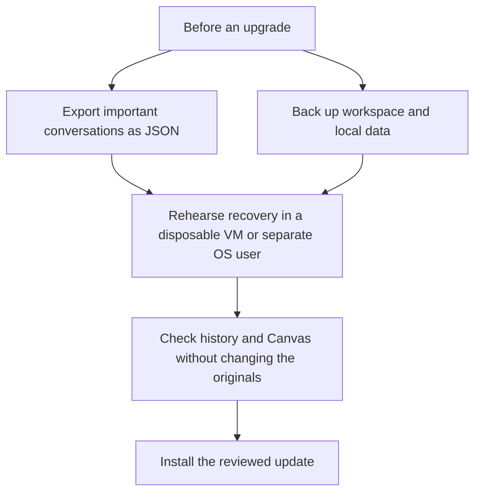

# Back up, upgrade and recover Mysti

[Documentation index](README.md) · [History and checkpoints](walkthroughs/history-and-checkpoints.md) · [Troubleshooting](TROUBLESHOOTING.md)

**Use JSON exports for portable conversations and a separate workspace/data backup for recovery.** A transcript, a code checkpoint and a complete backup preserve different things. This guide describes the **2.0.1 Beta 2** implementation; it does not certify every upgrade/downgrade combination.

## Choose what you need to preserve

| Your goal | Use | Important boundary |
| --- | --- | --- |
| Move a conversation to another installation | **Export JSON file** | Preserves structured conversation metadata, but omits embedded attachment bytes. Imported checkpoints cannot rewind another workspace. |
| Keep a readable transcript | **Export Markdown file** | Keeps text and roles; does not preserve the full structured conversation. |
| Explore another conversational direction | **Fork** | Creates another conversation branch; it is not a filesystem backup. |
| Rewind supported local code changes | A valid Mysti checkpoint | Depends on that workspace's retained checkpoint repository and file coverage. Keep normal version control and backups too. |
| Recover after an editor/profile/storage failure | An offline copy of editor data, workspace files and relevant Mysti directories | Credentials may require sign-in again. Test the copy in a separate environment before replacing any working data. |



## Export a conversation

1. Open the conversation you want to keep and wait for the current response to finish, or use **Stop**.
2. Open the composer's **⋯ Actions** menu. Search for **Export JSON file** and select it.
3. Save the proposed `conversation.mysti.json` file in a private backup location. Give it a useful name and keep the original extension.
4. Open the saved file locally to confirm the title and expected messages are present. Treat it as private: context, tool records and file paths can be included.
5. Repeat for other important conversations. The menu exports the selected conversation; there is no bulk account backup action.

For a readable copy, select **Export Markdown file**. **Copy conversation as Markdown** writes to the clipboard instead of a file; save that text yourself if you want to retain it.

**JSON limits:** attachment metadata can remain, but the export strips `base64Data`. Keep the original attachment files separately. Tool records may already be bounded/truncated by history storage. Conversation exports do not include project files, Canvas documents, saved credentials, all extension settings, or the checkpoint Git repository.

## Import and check the result

1. Open Mysti in the destination installation and create/open a chat.
2. Open **⋯ Actions → Import conversation** and choose the saved file.
3. Wait for the import result. It creates a new conversation; it does not merge into or overwrite an existing conversation.
4. Check the title, selected provider/model, message count/order and important answers. Read any import notice before continuing.
5. Reattach files that are still needed. Confirm the destination provider account and access mode before sending a new message.

| Accepted input | What to expect |
| --- | --- |
| Mysti `.mysti.json`, format version 1 | Structured conversation metadata and normalized messages. New IDs are assigned. |
| Generic `.json` with a supported `messages` array | Best-effort normalized conversation import; fields must have supported shapes. |
| Mysti `.md` transcript | Text and roles. The exported file's framing preserves message boundaries; older heading-only transcripts are best-effort. |
| OpenClaw `.jsonl` | Best-effort supported conversation records, not a universal JSONL importer. |

Imported tool calls are historical records and cannot undo local files. Imported checkpoint references are removed. Share links contain a bounded text transcript, and long conversations may fall back to JSON on the clipboard; use the explicit JSON file export for backups.

## Where data lives

These paths describe the **extension host**. A remote/WSL/container host, a named profile, VS Code Insiders, portable mode, or `--user-data-dir` can change the editor-owned location. The application resolves those locations through VS Code's storage APIs rather than assuming a desktop path.

| Data | Storage used by Mysti | Include in a recovery backup? |
| --- | --- | --- |
| Conversations and current history selection | VS Code extension `globalState`, key `mysti.conversations` | Export important conversations; include the editor data snapshot for full local recovery. |
| Preserved unreadable history | `globalState` keys beginning `mysti.conversations.corrupt.` | Preserve the editor data snapshot when a recovery warning appears. These are not ordinary export files. |
| Settings | VS Code User/Profile settings and applicable workspace `.vscode/settings.json` | Yes; review secrets in settings before copying or sharing. |
| Workspace memories and local counters | VS Code `workspaceState`, including `mysti.crossBackendMemory.v1` | Include editor workspace storage if you need them. A JSON conversation export omits them. |
| Canvas documents and assets | `<workspace>/.mysti/canvas/<artifact-id>/`, including `artifact.json` and any `.bak`/asset files | Yes, along with the workspace. Keep complete artifact directories. |
| Full compaction history | `<workspace>/.mysti/compaction/<panel-id>/history.jsonl` | Include if needed; it can contain full tool output and private context. |
| User agents and memory | `~/.mysti/agents/`, `~/.mysti/memory/`, `~/.mysti/projects/<hash>/memory/` | Include the relevant directories. `~` is the extension-host user's home. |
| Workspace agents and staged skills | `<workspace>/.mysti/agents/`, `<workspace>/.mysti/skills.staged/` | Include with workspace customizations. |
| Code checkpoints | `<extension-global-storage>/checkpoints/<workspace-hash>/git/` | Include if you need retained checkpoints; moving the workspace can change its hash. |
| Visual observation screenshots | `<extension-global-storage>/visual/<session-key>/` | Optional, depending on what evidence you need. The dashboard's in-memory observation list is not a durable report archive. |
| Provider credentials | VS Code SecretStorage, selected machine settings/environment variables, or provider-owned stores | Plan to sign in again. An editor-data copy is not a portable credential backup. See [Privacy](PRIVACY.md#credentials-and-settings). |

Checkpoints currently use the **first folder** in a multi-root workspace. Back up every project folder you need, and do not assume one checkpoint covers all roots.

For **standard desktop VS Code, default profile**, the usual data locations are:

| OS | VS Code user-data directory | Default extension file storage |
| --- | --- | --- |
| Windows | `%APPDATA%\Code` | `%APPDATA%\Code\User\globalStorage\deepmyst.mysti` |
| macOS | `~/Library/Application Support/Code` | `~/Library/Application Support/Code/User/globalStorage/deepmyst.mysti` |
| Linux | `~/.config/Code` | `~/.config/Code/User/globalStorage/deepmyst.mysti` |

`globalState` is managed by VS Code's storage database, commonly `User/globalStorage/state.vscdb` in the default profile; it is not a JSON file inside `deepmyst.mysti`. Workspace state is managed under `User/workspaceStorage/`. Named profiles have their own profile data. Inspect your actual installation/profile instead of assuming that a missing default path means your data is gone. **Preferences: Open User Settings (JSON)** helps identify the active settings file; [VS Code's settings documentation](https://code.visualstudio.com/docs/configure/settings) explains profile-specific paths.

## Take a complete offline snapshot

1. Export the important conversations and save unsent drafts separately. Confirm there is no “saving disabled” warning.
2. Save files and stop active Mysti work. Record the Mysti/VS Code versions and keep the reviewed VSIX and its checksum.
3. Close **all VS Code windows using that user-data directory**. This lets the editor finish database writes before you copy its data.
4. Copy the complete applicable VS Code user-data directory to a private, dated backup location. Include the full directory rather than copying a database while it is open or selecting only one database sidecar.
5. Back up the workspace, including its relevant `.mysti/` content, plus the required `~/.mysti/` directories. Hidden or Git-ignored data is not automatically included in a normal Git commit.
6. Keep the snapshot unchanged. Store secrets and backups according to your own organization's requirements; do not attach this backup to an issue.

A copied extension-global-storage directory alone does **not** include all conversation history. A VS Code settings/profile export alone is also not a Mysti data backup. VS Code SecretStorage and provider login stores may depend on the original OS account/keychain and are not guaranteed to transfer.

## Rehearse recovery without overwriting live data

Use a **disposable VM or separate OS user**, a copy of the snapshot, and a copy of the workspace. Editor data directories alone do not isolate home-directory memories, provider credentials or automatic MCP configuration reconciliation. These steps define a recovery check; they are not a claim that an arbitrary older build can read newer state.

1. In that separate environment, create two new directories for recovery editor data and recovery extensions. Copy the saved user-data directory's **contents** into the new recovery data directory, preserving its `User` subtree. Keep network access disabled for the first saved-data inspection so copied account/sync state cannot contact services.
2. Install the **same reviewed Mysti version** into the separate extension directory, then open the workspace copy:

```sh
code --user-data-dir "<recovery-data-dir>" --extensions-dir "<recovery-extensions-dir>" --install-extension "<reviewed-mysti.vsix>"
code --new-window --user-data-dir "<recovery-data-dir>" --extensions-dir "<recovery-extensions-dir>" "<workspace-copy>"
```

Replace each placeholder with an actual path. The `code` launcher must be installed. These switches are described in [VS Code's CLI guide](https://code.visualstudio.com/docs/configure/command-line); portable mode overrides them, so use a normal desktop installation for this procedure.

3. Keep Settings Sync off in the recovery instance before allowing network access. Confirm the expected history and settings; inspect a Canvas document from the copied `.mysti/canvas/` directory. Do not send an agent task merely to inspect saved data.
4. If restoring conversations through JSON instead, follow [Import and check the result](#import-and-check-the-result) in this separate instance.
5. Verify the original project and original editor data remain untouched. Keep the backup until you have resumed work successfully.

The two CLI switches isolate editor data and installed extensions; the separate OS account/VM isolates home-directory data and provider configuration. Copied settings can still contain absolute paths: review them before enabling native tools. A workspace copy also has a different path, so its old checkpoint hash may not match. Do not force checkpoint restoration into a relocated project. Use your project backup/version control for file recovery.

## Upgrade and rollback

Before updating, make the exports/snapshot above. Install the reviewed VSIX with **Extensions: Install from VSIX**, reload when prompted, and check history, settings and Canvas before starting new work. Record the exact version and channel; [GitHub releases](https://github.com/DeepMyst/Mysti/releases) and registry listings can differ.

If the update fails, preserve the new state and error first. Try the prior reviewed VSIX against a **copy of the pre-upgrade snapshot** in the recovery environment. Do not install an older build over the only copy of newer data. A newer schema is intentionally refused by current history/Canvas guards; that preserves bytes but does not establish full backward compatibility. The [readiness report](PRODUCTION_READINESS.md#remaining-work-toward-a-stable-release) tracks remaining upgrade/downgrade acceptance.

## When history cannot be loaded or saved

| Warning or symptom | What Mysti does | Your next step |
| --- | --- | --- |
| Saved history was written by a newer version | Refuses to read or overwrite that store; the current session does not persist. | Export/copy any new visible work, preserve the data, and reopen with the compatible newer version. |
| Part of history could not be read | Attempts to park the original value under a separate recovery key before saving repaired history. | Keep the full warning and make an offline snapshot. Report the issue with a small redacted example if possible. |
| The recovery copy could not be saved | Leaves the original live key unchanged and disables saving. | Preserve new text outside the panel before reload; check disk space/permissions and collect logs. |
| “Failed to save conversation history” | Reports the failed write. The displayed response alone is not proof it reached disk. | Export/copy visible work, inspect storage errors, and verify recovery from a copy. |
| Canvas reports a corrupt or newer artifact | Preserves the problematic file and can report whether a usable backup exists. | Copy the whole artifact directory first; follow any offered recovery action and verify the result. Do not replace it with a blank document. |

Do not edit `state.vscdb` or remove recovery keys as a troubleshooting shortcut. There is no user-facing automatic restore command for parked conversation blobs. Use the [support guide](TROUBLESHOOTING.md#report-a-reproducible-issue) for assistance while retaining the original bytes.

## Source and scope

Contracts are implemented in [ConversationManager](../src/managers/ConversationManager.ts), [conversation transfer handlers](../src/providers/ChatViewProvider.ts), [ArtifactStore](../src/managers/ArtifactStore.ts), [CheckpointManager](../src/managers/CheckpointManager.ts), [HistoryStore](../src/services/HistoryStore.ts), [MemoryManager](../src/managers/MemoryManager.ts) and [MystiMemoryStore](../src/services/MystiMemoryStore.ts). VS Code owns [`ExtensionContext` storage and secrets](https://code.visualstudio.com/api/references/vscode-api#ExtensionContext). The release's [validation report](releases/2.0.1-beta.2/VALIDATION.md) describes the recovery journeys actually exercised.
