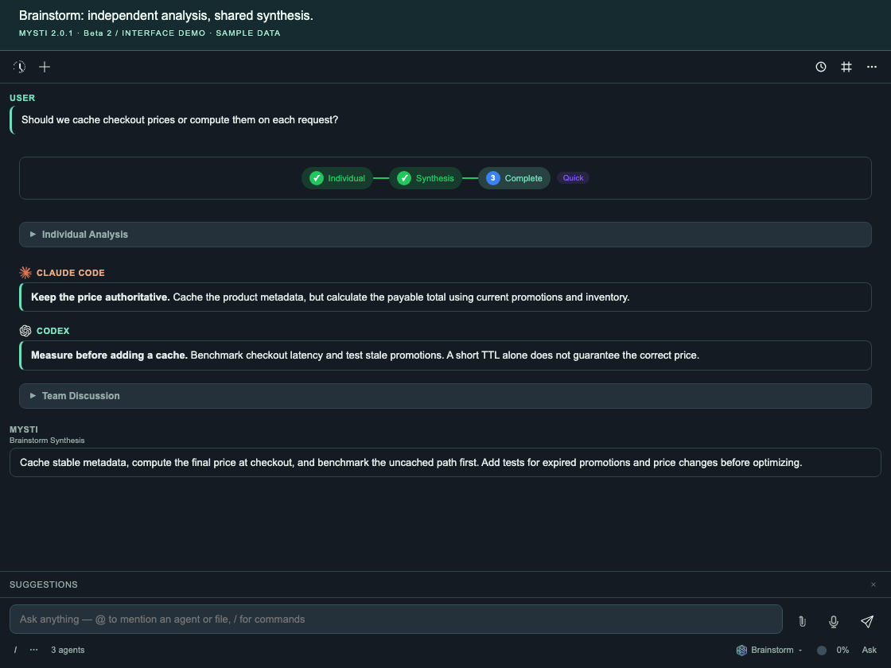
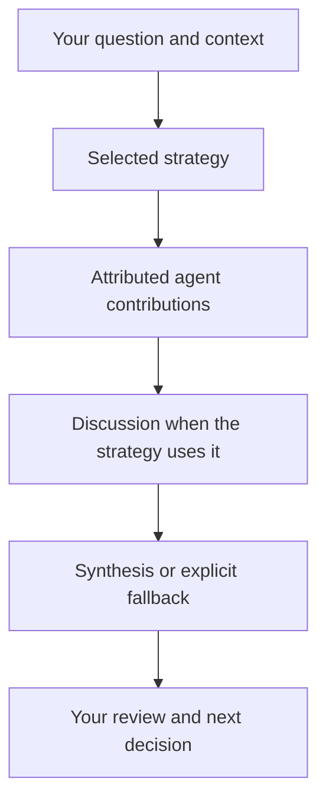

# Brainstorm Mode & Team Reasoning

Brainstorm combines two configured agents using a selected discussion strategy. It produces attributed contributions and a synthesis to review; agreement is not proof that the answer is correct.

[Documentation index](README.md) · [Visual multi-agent walkthrough](walkthroughs/multi-agent-workflows.md) · [Settings reference](SETTINGS.md)

## Try a first discussion

1. Configure and test both providers independently using [Provider setup](PROVIDERS.md#first-successful-request). They must support the selected access mode.
2. Select **Brainstorm** in the agent menu, then open Settings. In **Brainstorm Agents**, select exactly two different providers.
3. Choose **Quick** in **Strategy** and ask: `Compare a fixed delay and exponential backoff for retrying failed API calls. Explain the trade-offs; do not change files.`
4. Read both attributed analyses and the final synthesis. If a provider fails or synthesis is unavailable, review the explicit error/fallback instead of treating it as a two-agent result.
5. Use **Stop** to cancel the active session. Resolve setup or capability failures before starting another.



*Labelled sample-data interface. [Watch the short Brainstorm demo](DEMO_GALLERY.md#brainstorm); native provider acceptance is recorded separately.*

## How It Works

1. You send a message with Brainstorm Mode enabled
2. Mysti passes the request and conversation context into the chosen strategy
3. Quick, Debate and Delphi begin with independent analysis; Red-Team starts with one proposer, while Perspectives assigns two different lenses
4. Discussion and synthesis use the contributions actually received, with failures and cancellation kept visible




## Selecting Your Team

Choose two configured, available agents in the settings panel. The picker follows the registered provider catalog; these are examples:

| Agent | Provider |
| --- | --- |
| Claude Code | Anthropic |
| Codex | OpenAI |
| Gemini | Google |
| Cline | Configured model backend |
| Copilot | GitHub |
| Cursor | Cursor |
| OpenClaw | Configured gateway/backend |

Configure via settings:
```json
{
  "mysti.brainstorm.agents": ["claude-code", "google-gemini"]
}
```

**Requirement:** Both selected providers must be available and authenticated where required. CLI agents need their tools installed; local/API backends need a working endpoint and any required credentials. See [provider setup](PROVIDERS.md).

## Collaboration Strategies

Mysti offers 5 collaboration strategies, each designed for different types of problems.

### Quick

A direct analysis-and-synthesis strategy with no discussion phase. Actual response time depends on the providers.

- Both agents respond independently
- Responses are immediately synthesized into one answer
- **Best for:** Simple questions, quick lookups, straightforward tasks

```json
{ "mysti.brainstorm.strategy": "quick" }
```

### Debate

Structured critique and rebuttal. Both agents critique in the first discussion round; subsequent rounds ask both to defend or revise their positions. Roles are assigned by round, not permanently to Agent 1 versus Agent 2.

- Agents review each other's solutions and engage in structured discussion
- Each round, agents respond to the other's arguments
- **Best for:** Architecture decisions, design trade-offs, evaluating approaches

```json
{ "mysti.brainstorm.strategy": "debate" }
```

### Red-Team

Adversarial testing where one agent tries to break the other's solution.

| Role | Agent | Behavior |
|------|-------|----------|
| **Proposer** | Agent 1 | Builds the solution, addresses challenges |
| **Challenger** | Agent 2 | Finds flaws, edge cases, security issues |

- The challenger actively tries to find problems with the proposer's solution
- The proposer must address each challenge
- **Best for:** Security reviews, error handling, edge case discovery, robustness testing

```json
{ "mysti.brainstorm.strategy": "red-team" }
```

### Perspectives

Complementary viewpoints from different analytical angles.

| Role | Agent | Behavior |
|------|-------|----------|
| **Risk Analyst** | Agent 1 | Identifies risks, maintenance burden, complexity |
| **Innovator** | Agent 2 | Explores creative solutions, new approaches |

- Agents provide complementary perspectives rather than opposing ones
- The synthesis balances innovation with risk awareness
- **Best for:** Greenfield design, technology selection, long-term planning

```json
{ "mysti.brainstorm.strategy": "perspectives" }
```

### Delphi

Iterative refinement toward consensus, inspired by the Delphi method.

| Role | Agent | Behavior |
|------|-------|----------|
| **Facilitator** | Configured synthesis agent, when selected; otherwise the first participant | Summarizes the current positions |
| **Refiners** | Participating agents with complete responses | Revise their proposals using that summary |

- Each round builds on the previous, progressively refining the solution
- Agents converge on a shared solution through iterative improvement
- **Best for:** Complex problems with many unknowns, reaching consensus, thorough exploration

```json
{ "mysti.brainstorm.strategy": "delphi" }
```

## Convergence Detection

In Debate and Delphi discussion rounds, Mysti can estimate agreement using text heuristics. This is a discussion signal, not a correctness or confidence score.

### How It Works

- **Agreement tracking**: Counts agreement keywords (agree, correct, good point, exactly, etc.)
- **Disagreement tracking**: Counts disagreement keywords (disagree, however, but, on the other hand, etc.)
- **Position stability**: Measures how much each agent's position shifts between rounds
- **Convergence score**: Calculated from agreement/disagreement ratio and position stability

### Auto-Convergence

When enabled, Debate and Delphi can stop further discussion rounds when the heuristic reports convergence **or stalled discussion**. The result still needs review. Quick, Red-Team and Perspectives use their own fixed phase structures.

```json
{
  "mysti.brainstorm.autoConverge": true
}
```

### Convergence UI

The webview shows a convergence meter during discussions:
- Progress bar showing convergence level
- Round markers on a discussion timeline
- Role badges for each agent's contributions

## Configuration

| Setting | Default | Description |
|---------|---------|-------------|
| `mysti.brainstorm.enabled` | `false` | Enable brainstorm mode |
| `mysti.brainstorm.agents` | `["claude-code","openai-codex"]` | Which 2 agents to use |
| `mysti.brainstorm.strategy` | `"quick"` | Collaboration strategy |
| `mysti.brainstorm.autoConverge` | `true` | Auto-exit when agents converge |
| `mysti.brainstorm.maxDiscussionRounds` | `2` | Discussion-round limit for Debate/Delphi (1–3) |

## Strategy Selection Guide

| Your Task | Recommended Strategy |
|-----------|---------------------|
| Quick answer needed | **Quick** |
| Choosing between approaches | **Debate** |
| Security or reliability review | **Red-Team** |
| Exploring new designs | **Perspectives** |
| Complex problem, need consensus | **Delphi** |

## Error Handling

Brainstorm Mode is designed to be resilient:

- Agent errors remain attributed. Strategies can continue with the available completed analysis rather than inventing a missing contribution.
- If the configured synthesis provider fails, Mysti can try another participant and reports the fallback.
- If synthesis remains unavailable, received analyses are shown with an explicit “Synthesis unavailable” label.
- Cancellation is terminal: it does not trigger another synthesis attempt or resume a later phase.

## Cancellation and availability

- **Silence-based timeout**: Child streams use the shared inactivity limit from [constants](../src/constants.ts), currently 30 minutes. Stop is available before that deadline; provider-specific failures can occur sooner.
- **Setup pre-check**: Providers report availability/authentication readiness before the session starts. A saved credential is not proof that the backend will accept the eventual request.
- **Synthesis fallback**: If the primary synthesis agent fails, a fallback agent is tried with UI feedback
- **Oscillation detection**: Detects when agents flip-flop between positions (round N matches round N-2)
- **Duplicate agent guard**: Prevents selecting the same agent twice
- **Cancel propagation**: Stop cancels the session and its owned child requests and prevents further phases or fallback. Process cleanup still depends on the provider transport; do not infer immediate descendant termination from the interface alone.

## Tips

1. **Start with Quick** for most tasks — it's the fastest and often sufficient
2. **Use Debate** when you're deciding between two approaches
3. **Use Red-Team** to look for edge cases, then verify findings with tests and review
4. **Choose compatible participants** whose accounts, models and access modes you have checked
5. **Inspect unresolved disagreements** and validate the synthesis independently; matching answers can share the same mistake

## Source and scope

This guide describes [BrainstormManager](../src/managers/BrainstormManager.ts) and its dedicated strategy settings. Session commands and explicit `@agent` assignments have separate orchestration; see [multi-agent workflows](walkthroughs/multi-agent-workflows.md). The shared [settings reference](SETTINGS.md) is authoritative for current defaults.
