# Mysti in action

Explore the everyday workflow: choose an agent, share the right context, bring in a second perspective, and stay in control of the result.

[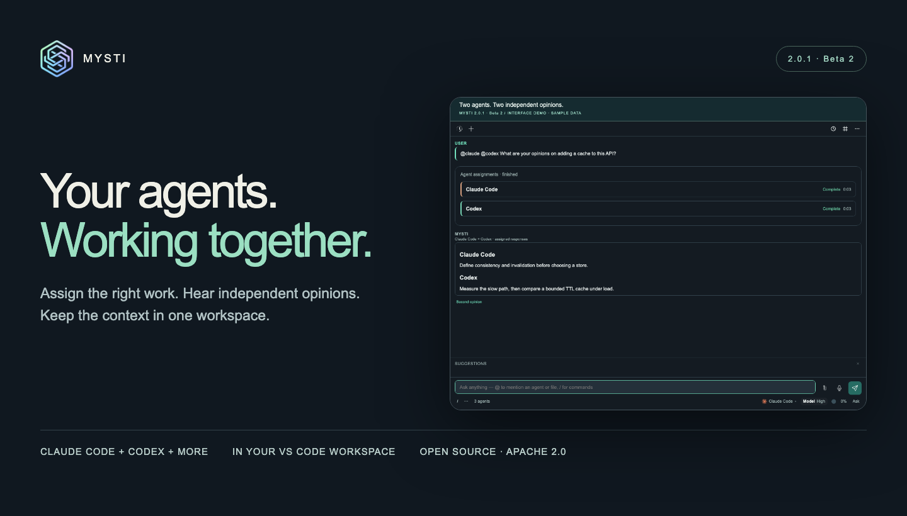](releases/2.0.1-beta.2/media/mysti-feature-tour.mp4)

**[Watch the complete tour](releases/2.0.1-beta.2/media/mysti-feature-tour.mp4)** · [Jump to a chapter](releases/2.0.1-beta.2/media/CHAPTERS.md) · [Download chapter captions](releases/2.0.1-beta.2/media/mysti-feature-tour.vtt) · [All previews](releases/2.0.1-beta.2/media/contact-sheet.jpg)

These recordings show the shipped interface with **clearly labelled sample data**. They run without model requests, account connections or private conversations. They explain how to use Mysti; release validation and known limitations are tracked separately in [production readiness](PRODUCTION_READINESS.md).

## Start with a focused task

| Preview | What you will learn |
| --- | --- |
| [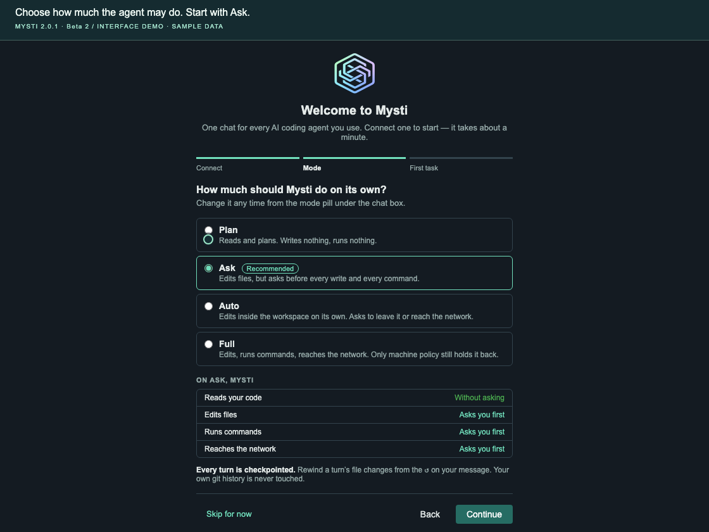](releases/2.0.1-beta.2/media/getting-started.mp4) | **Connect and get started** — select an available agent, compare Plan and Ask, then write a first task. [Watch](releases/2.0.1-beta.2/media/getting-started.mp4) |
| [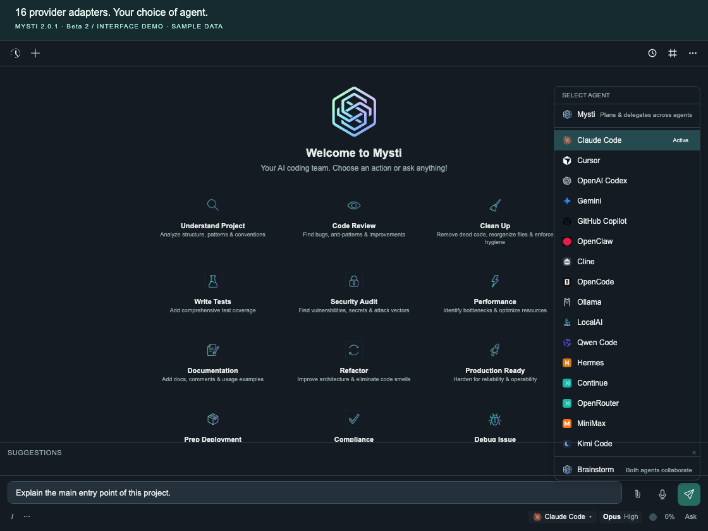](releases/2.0.1-beta.2/media/provider-switching.mp4) | **Choose your provider** — move between agent adapters while keeping your draft. Availability depends on your installed tools and accounts. [Watch](releases/2.0.1-beta.2/media/provider-switching.mp4) |
| [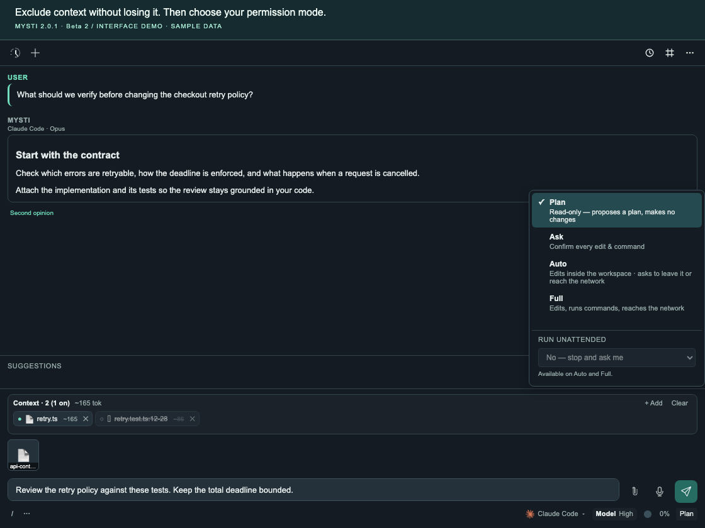](releases/2.0.1-beta.2/media/context-and-trust.mp4) | **Control context and permissions** — include files and selected lines, attach a document, temporarily exclude context, and choose Plan. [Watch](releases/2.0.1-beta.2/media/context-and-trust.mp4) |
| [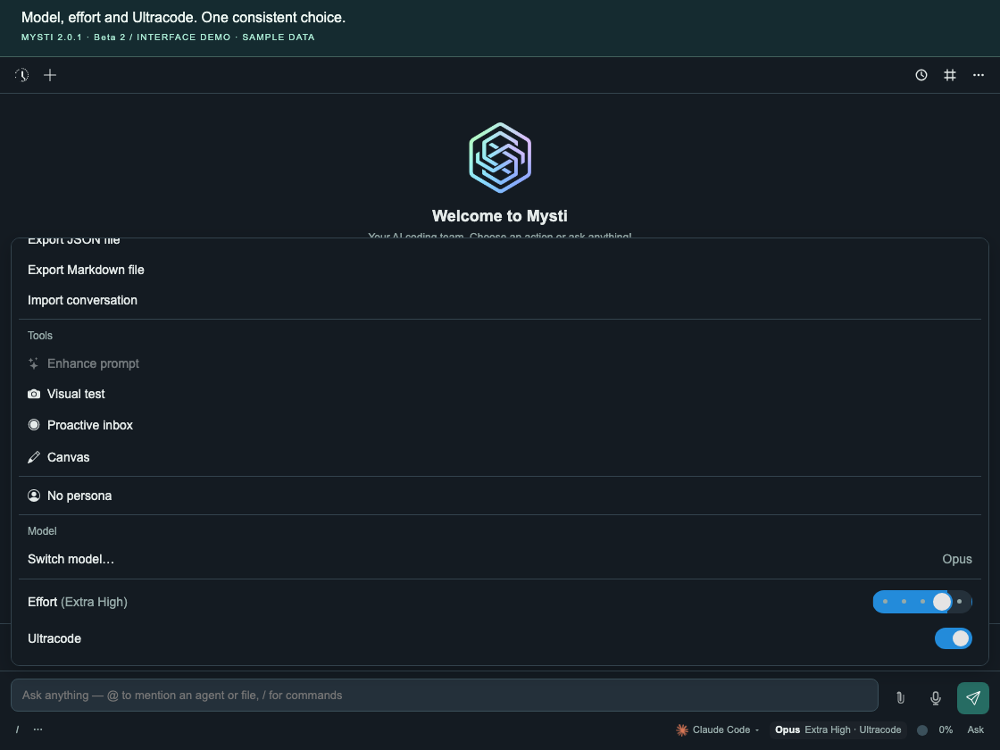](releases/2.0.1-beta.2/media/composer-controls.mp4) | **Tune the response** — choose model and effort, with Ultracode synchronized across the composer controls. Supported controls vary by provider. [Watch](releases/2.0.1-beta.2/media/composer-controls.mp4) |

## Bring agents together

| Preview | What you will learn |
| --- | --- |
| [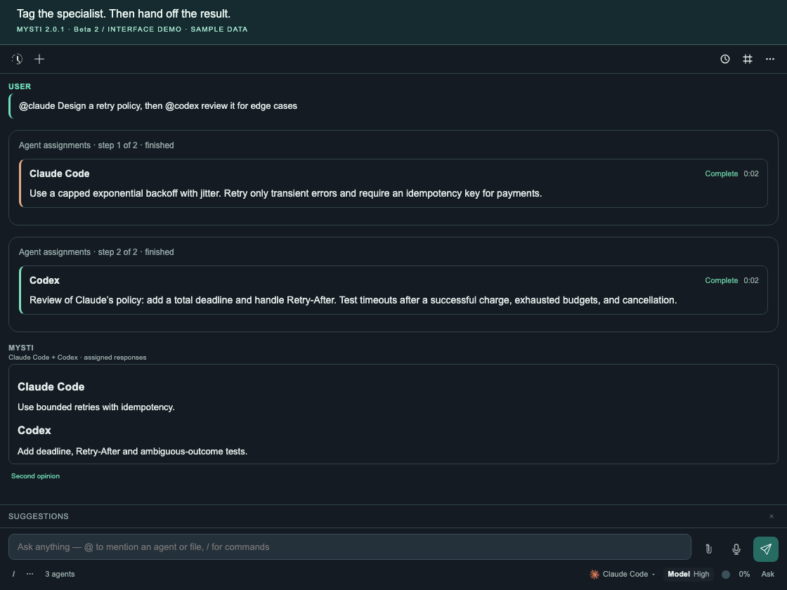](releases/2.0.1-beta.2/media/agent-workflow.mp4) | **Design, then review** — an explicit “then” makes the second assignment depend on the first. Follow each agent's progress and attribution. [Watch](releases/2.0.1-beta.2/media/agent-workflow.mp4) · [GIF](releases/2.0.1-beta.2/media/agent-workflow.gif) |
| [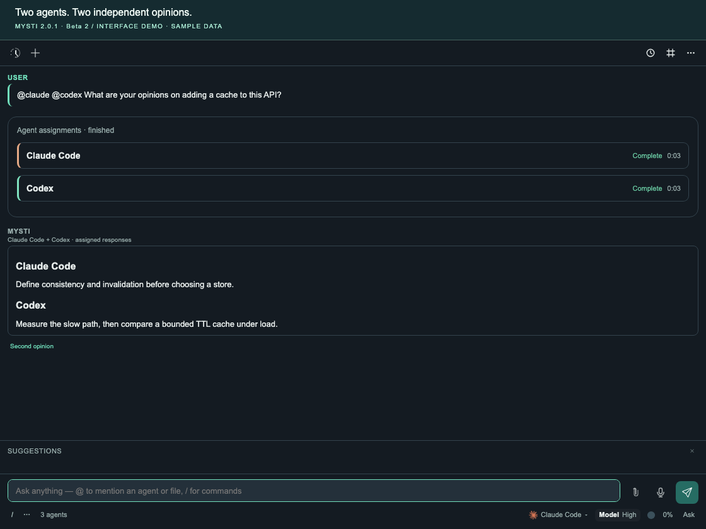](releases/2.0.1-beta.2/media/agent-opinions.mp4) | **Compare independent opinions** — address two agents in one message and read their separate answers. [Watch](releases/2.0.1-beta.2/media/agent-opinions.mp4) |
| [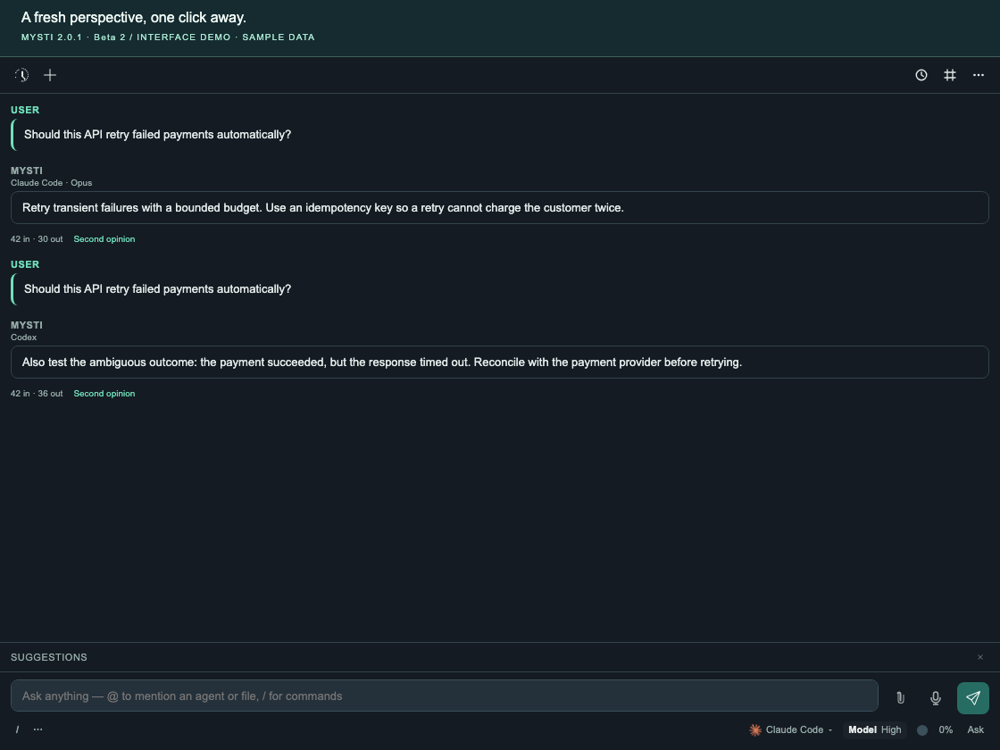](releases/2.0.1-beta.2/media/second-opinion.mp4) | **Ask for another perspective** — use Second opinion on a finished answer to send the original question to another agent. [Watch](releases/2.0.1-beta.2/media/second-opinion.mp4) |
| [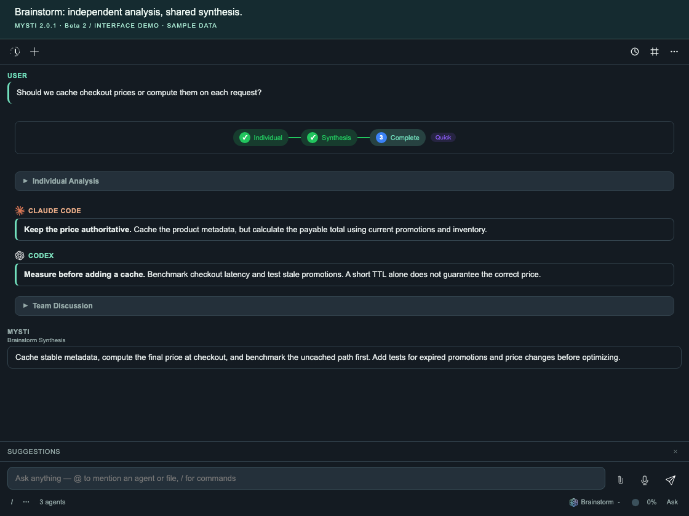](releases/2.0.1-beta.2/media/brainstorm.mp4) | **Brainstorm a decision** — watch the Quick strategy gather independent analysis and produce a shared synthesis. [Watch](releases/2.0.1-beta.2/media/brainstorm.mp4) |

## Keep control of your work

| Preview | What you will learn |
| --- | --- |
| [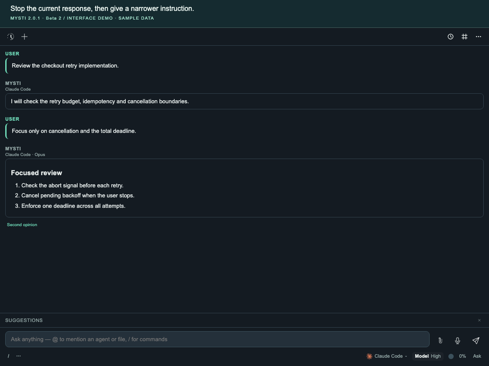](releases/2.0.1-beta.2/media/stop-and-recovery.mp4) | **Stop and refocus** — stop a running response and start a narrower follow-up. This scene demonstrates the interface; native subprocess cleanup has separate regression evidence. [Watch](releases/2.0.1-beta.2/media/stop-and-recovery.mp4) |
| [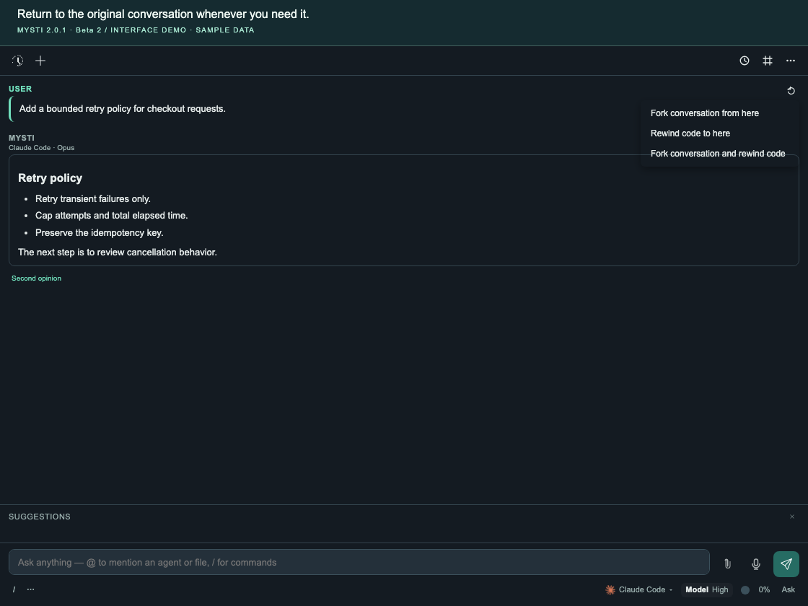](releases/2.0.1-beta.2/media/history-and-rewind.mp4) | **Return, branch or rewind** — open earlier work and find the message-level fork and code-rewind actions. The demo branches sampled history; it does not modify files on disk. [Watch](releases/2.0.1-beta.2/media/history-and-rewind.mp4) |
| [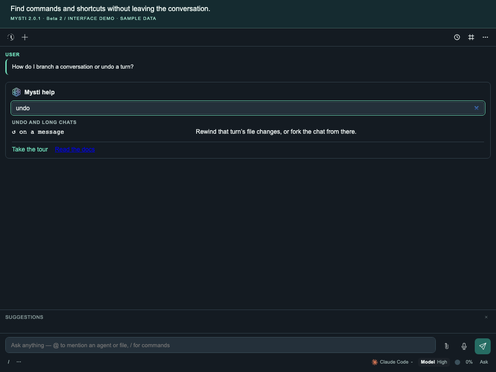](releases/2.0.1-beta.2/media/settings-and-help.mp4) | **Find settings and help** — open the conversation-bound settings hub, choose a persona and a skill, and search built-in help. [Watch](releases/2.0.1-beta.2/media/settings-and-help.mp4) |

## Design and inspect visually

| Preview | What you will learn |
| --- | --- |
| [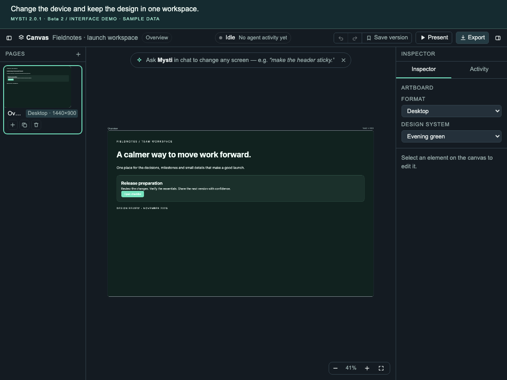](releases/2.0.1-beta.2/media/canvas-design.mp4) | **Explore a design in Canvas** — see the actual sandbox runtime render a sample design, change its theme and device format, and find Export. The host operations are fixtures; no export file is produced. [Watch](releases/2.0.1-beta.2/media/canvas-design.mp4) |
| [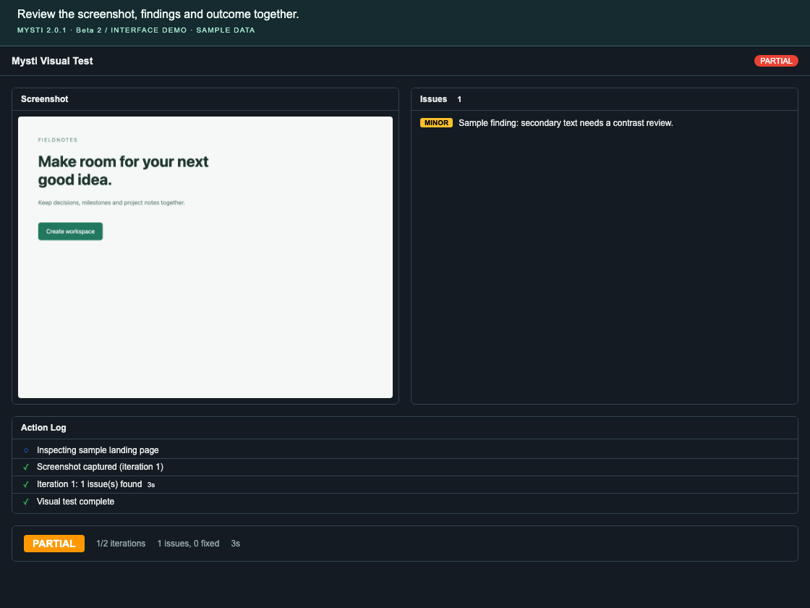](releases/2.0.1-beta.2/media/visual-test.mp4) | **Read a visual report** — configure a check and review a screenshot, issue list and result together. Findings and the report are sample data. [Watch](releases/2.0.1-beta.2/media/visual-test.mp4) |

## Work with connected context

| Preview | What you will learn |
| --- | --- |
| [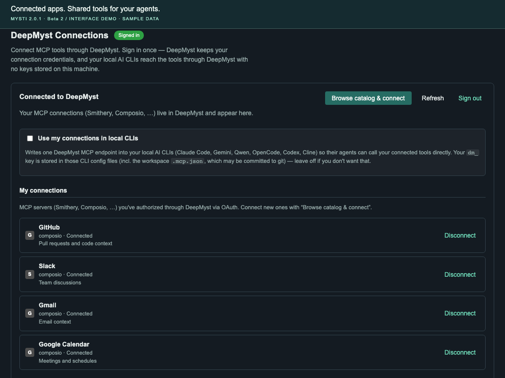](releases/2.0.1-beta.2/media/connected-tools.mp4) | **Manage connected tools** — find the catalog action and refresh a sample connection list. No OAuth flow or external application is executed. [Watch](releases/2.0.1-beta.2/media/connected-tools.mp4) |
| [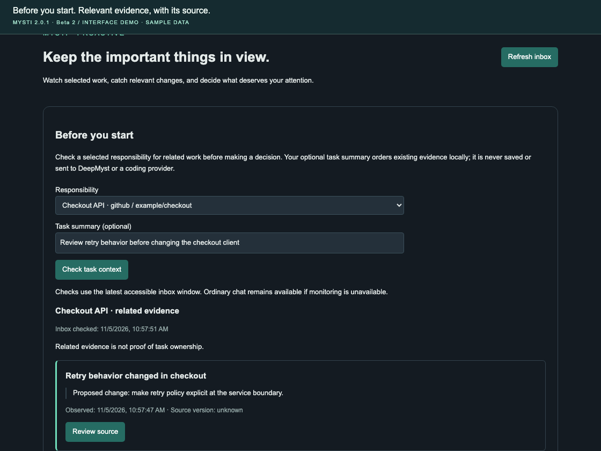](releases/2.0.1-beta.2/media/proactive-inbox.mp4) | **Check relevant evidence** — create a task briefing and inspect its cited context before starting work. The remote evidence is a fixture. [Watch](releases/2.0.1-beta.2/media/proactive-inbox.mp4) |

## Scope and coverage

The 15 scenes cover the main product surfaces. The [capture manifest](releases/2.0.1-beta.2/media/capture.json) maps each scene to the [feature inventory](../plans/47-feature-inventory.md), records durations and output sizes, and states its evidence boundary. A recorded control is not proof that every provider supports it.

Not covered by this tour: all five Brainstorm strategies; full autonomous or unattended runs; Desk cross-machine pairing; live plugin installation; remote channel messaging; image/video generation; every Canvas editing and approval operation; real OAuth; paid model execution; sustained-load tests; Windows and Linux parity. These require separate, appropriately scoped validation and, where useful, additional recordings.

Historical [live Claude Code and Codex footage](releases/2.0-beta/README.md#live-provider-evidence) remains available with its original package hash and version. It is evidence for that earlier build, not a live test of this release.

## Reproduce the recordings

Use the repository's pinned development Node version, install the locked dependencies, and install FFmpeg on your machine. Then run:

```sh
npm ci
npm exec --no -- playwright install chromium
npm run demo:record
```

The recorder loads shipped UI assets locally and blocks HTTP(S). It uses no provider credentials and writes only release media and temporary recording files. Each scene checks its key interactions, rejects uncaught browser errors and broken visible images, and records a PNG poster plus an H.264 MP4 at 1120 × 840. One focused GIF is generated for the README; the combined tour includes chapter metadata and a separate WebVTT file with chapter captions.

To regenerate selected scenes during editing:

```sh
MYSTI_DEMO_SCENES=canvas-design,visual-test npm run demo:record
```

When a complete prior capture exists for the same version and the checked UI source assets are unchanged, selected-scene runs also rebuild the tour, chapter list and manifest. Existing clip hashes are checked before reuse, and each scene retains its capture time and recorder-source hashes. If source assets changed or there is no complete capture, run without `MYSTI_DEMO_SCENES` before publishing. `MYSTI_DEMO_OUTPUT` and `MYSTI_DEMO_LABEL` can select the destination and release caption for a future version.

Before publishing, watch the tour, inspect its posters at README size, check that sample-data labels stay visible, and confirm every media link resolves. Keep these assets in the repository or release media kit; `docs/**` is excluded from the VSIX.
