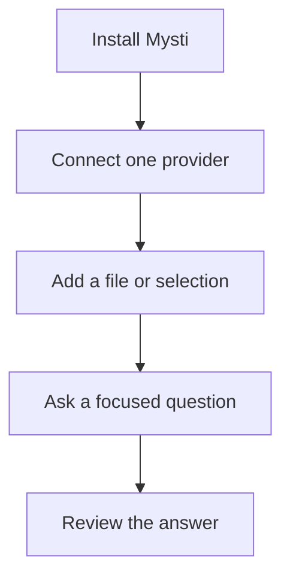

# Getting started with Mysti

[Documentation index](README.md) · [Visual walkthroughs](walkthroughs/README.md) · [Troubleshooting](TROUBLESHOOTING.md)

**Your first goal:** connect one provider, add a small piece of context, and get a useful answer. This guide targets **2.0.1 Beta 2**. You can add a second agent after the first one works.



## Install and open

Use VS Code 1.86 or newer and a trusted local workspace on Windows, macOS, or Linux. For the reviewed Beta 2 package, download the VSIX from the [GitHub release](https://github.com/DeepMyst/Mysti/releases/tag/v2.0.1-beta.2), then run **Extensions: Install from VSIX**. You can also install the version currently listed as `DeepMyst.mysti` in Extensions. GitHub and Marketplace versions can differ. Reload the window after replacing an installed version; use the [backup and upgrade guide](BACKUP-AND-RECOVERY.md) before updating an installation with important history.

Open **Mysti: Open Chat** from the command palette or click Mysti in the Activity Bar. Opening a separate editor tab gives a larger workspace for comparisons and visual work.

## Configure one agent

Choose an agent in the composer and follow the setup screen. Installation, CLI discovery, authentication, and model support are separate checks: completing an installer does not imply sign-in is complete.

- **Claude Code / Codex / another CLI:** use the provider's install and authentication actions. If Mysti detects a model compatibility error requiring a newer CLI, use the upgrade action and wait for discovery to refresh.
- **Mysti:** sign in to DeepMyst, or configure the direct OpenRouter route. Delegating to a local CLI still requires that CLI's setup.
- **Ollama / LocalAI / OpenRouter / MiniMax:** configure the appropriate endpoint or account. These are not all installed through npm.

See [Providers](PROVIDERS.md) for adapter-specific details. Model catalogs and account entitlements can differ from examples in screenshots.

**Check:** the setup screen should recognize the intended provider and model/account. If any step fails, use the matching [troubleshooting symptom](TROUBLESHOOTING.md#find-your-symptom) before continuing.

<a id="assign-a-task"></a>

## Complete your first task

1. Open a small source file in your project and select a function.
2. Right-click and choose **Add to Mysti Context**. Confirm that the intended file/selection appears in the chat's context.
3. Choose a supported access mode, then send:

```text
Explain this function and suggest one useful test. Do not change files.
```

4. Read the answer and inspect any requested actions. Check that it refers to the selected code.

**Success looks like:** an attributed answer about your selected context, with no unexpected file changes. Prompts and included context go to the configured provider; [Privacy and data controls](PRIVACY.md) explains the routes and local storage.

## Add another perspective

After both participating providers are configured, try:

```text
@claude Explain this function
@claude @codex What are your opinions on this design?
@claude Write the parser, then @codex review it
@claude:critic @codex:reviewer Assess this proposal
```

The selected provider does not absorb explicit assignments. Opinion requests have separate, concurrent read-only runs. A `then` handoff waits for the preceding assignment. Work that may write files runs serially and retains your permission settings.

Add files through Context or `@path/to/file`. Explicit collaborator runs currently do not forward composer attachments; the UI warns you to use Context. Dictation inserts text into your draft and does not send it automatically.

## Read the results

Each live assignment card identifies its agent and status. The final conversation stores attributed answers so reopening it preserves who said what. A missing, unauthenticated, timed-out, or failed participant is reported rather than replaced. Stop cancels active collaborators; a new send supersedes the previous run.

`@agent:role` controls perspective and access. Unknown or unverified roles do not gain write authority. See [Mentions](MENTIONS.md).

Follow the [visual multi-agent walkthrough](walkthroughs/multi-agent-workflows.md) for an independent review and an ordered handoff. To keep useful work, use [Export JSON file](BACKUP-AND-RECOVERY.md#export-a-conversation); unsent drafts are not a durable backup.

## Choose your next walkthrough

| Your next goal | Follow |
| --- | --- |
| Explore a layout across devices and themes | [Canvas](walkthroughs/canvas.md) |
| Inspect a running application | [Visual Test](walkthroughs/visual-test.md) |
| Continue, fork or rewind earlier work | [History and checkpoints](walkthroughs/history-and-checkpoints.md) |
| Compare two agents or hand off completed work | [Multi-agent workflows](walkthroughs/multi-agent-workflows.md) |

[Watch the short feature demos](DEMO_GALLERY.md) for a preview of each workflow. The recordings use labelled sample data; their captions do not replace provider setup or live-service validation.

## Try connected context

Open **Mysti: Open Proactive Inbox**. Local Git monitoring needs a chosen workspace and the editor running. Cloud GitHub/Slack monitoring needs DeepMyst sign-in, a supported connected account, and a responsibility you explicitly create. Review evidence before acting on it; author metadata is not task ownership. [Setup and limits](PROACTIVE.md).

## If something goes wrong

| Symptom | Check |
| --- | --- |
| An agent is unavailable | Its setup card: installed path, CLI version, and sign-in are distinct checks. |
| A model is rejected | Choose a model your account supports; use an offered CLI upgrade if required. |
| Only one opinion arrives | Inspect the other agent's card and error. Retry after fixing its setup. |
| Work runs serially | Writers and explicit dependencies serialize. Independent read-only work respects `mysti.collab.maxConcurrent`. |
| Dictation has no microphone support | Follow the editor's speech setup prompt and OS microphone permissions. |
| DeepMyst sign-in fails | Retry sign-in, inspect the reported error, and include the HTTP status in a bug report. Never share tokens. |

For detailed diagnosis, use [Troubleshooting](TROUBLESHOOTING.md), including [where to find and redact logs](TROUBLESHOOTING.md#collect-useful-logs). For missing history or a failed upgrade, preserve the data and use [Backup and recovery](BACKUP-AND-RECOVERY.md). The [settings reference](SETTINGS.md) lists exact keys and defaults.
