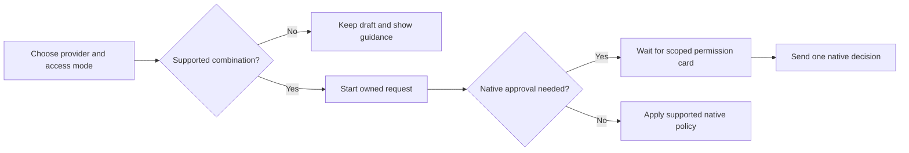

# Provider approval contracts

This reference describes the implemented transport policy for the **2.0.1 Beta 2 source line**. An available mode is not a certification of every CLI release, account, tool or OS. Current native acceptance gaps are recorded in [production readiness](PRODUCTION_READINESS.md#provider-acceptance-still-needed).

[Documentation index](README.md) · [Provider setup](PROVIDERS.md#permissions-and-compatibility) · [Privacy](PRIVACY.md)

## Choose a provider for the authority you need

A native approval bridge receives a permission **request**, waits for Mysti's decision and sends a scoped native response. A streamed tool **notification** only reports activity; pausing after a notification cannot establish that execution waited for consent.

`supportsNativeApproval` identifies an implemented native request/response bridge; it does not certify that every native operation emits a permission request. Mysti exposes these bridges for Claude Code, Codex, Hermes, Kimi's emitted ACP requests, and OpenCode's remote HTTP/SSE transport. Kimi nevertheless rejects restricted modes because native saved permissions can bypass those requests. OpenCode local CLI and remote server are separate contracts.



## Current provider matrix

“Read-only” below describes configured native flags and host checks, **not an OS sandbox guarantee**. Unrestricted execution requires both mode and access to permit tools; Full Access alone does not override Ask Before Edit.

| Provider / transport | Ask / approval-based work | Plan / Read Only | Implementation |
| --- | --- | --- | --- |
| Claude Code | Native stream-json permission request waits for the host card; startup failure does not fall back to an unrestricted process | Native plan plus host mutation denial | [Claude adapter](../src/providers/claude/ClaudeCodeProvider.ts) |
| Codex | App-server command/file requests wait for scoped decisions | Read-only sandbox and host checks; external MCP/app tools disabled in restricted threads | [Codex adapter](../src/providers/codex/CodexProvider.ts) |
| Gemini | Rejected before the noninteractive CLI starts | `--approval-mode plan` | [Gemini adapter](../src/providers/gemini/GeminiProvider.ts) |
| Cline | Rejected before the CLI starts | Legacy 1.x maps to `--mode plan`; modern or unknown versions reject Plan/Read Only | [Cline adapter](../src/providers/cline/ClineProvider.ts) |
| Copilot | Rejected before the CLI starts | Native `--deny-tool shell` and `--deny-tool write` | [Copilot adapter](../src/providers/copilot/CopilotProvider.ts) |
| Cursor | Rejected before the CLI starts | Explicit `--mode plan` | [Cursor adapter](../src/providers/cursor/CursorProvider.ts) |
| OpenClaw | Rejected; only explicitly unrestricted tool authority is accepted | Rejected | [OpenClaw adapter](../src/providers/openclaw/OpenClawProvider.ts) |
| OpenCode local CLI | Rejected; configurable native agent/session policies cannot enforce Mysti's restricted contract | Rejected | [OpenCode adapter](../src/providers/opencode/OpenCodeProvider.ts) |
| OpenCode remote HTTP/SSE | Server permission requests wait for the owning Mysti handler | Turn-specific permission rules and host checks deny non-read tools | [Remote transport](../src/providers/opencode/OpenCodeRemote.ts) |
| Qwen Code | Rejected; only explicitly unrestricted tool authority is accepted | Rejected | [Qwen adapter](../src/providers/qwen/QwenCodeProvider.ts) |
| Hermes | Emitted ACP requests wait for the scoped card when host policy requires approval | Non-read permission requests are denied | [Hermes adapter](../src/providers/hermes/HermesProvider.ts), [ACP bridge](../src/providers/base/AcpApproval.ts) |
| Kimi Code | Rejected before dispatch; bridge retained only for emitted requests in unrestricted sessions | Rejected; native saved allows can bypass requests | [Kimi adapter](../src/providers/kimi/KimiCodeProvider.ts) |
| Continue | Uses `--readonly` because this final-text transport cannot prompt for approval | `--readonly` | [Continue adapter](../src/providers/continue/ContinueProvider.ts) |
| Ollama, LocalAI | Tool proposals can be displayed; these adapters never execute them | No adapter tool execution | [Ollama](../src/providers/ollama/OllamaProvider.ts), [LocalAI](../src/providers/localai/LocalAIProvider.ts) |
| OpenRouter, MiniMax | Completion backends; no adapter tool execution | No adapter tool execution | [OpenRouter](../src/providers/openrouter/OpenRouterProvider.ts), [MiniMax](../src/providers/minimax/MiniMaxProvider.ts) |

The **Mysti coordinator** is separate from these provider adapters. Its own tools use host policy, workspace trust, machine-scoped authority settings and optional tool gates. Delegating to an adapter does not give that adapter a stronger permission contract. See [architecture](ARCHITECTURE.md#authority-and-persistence).

## Ownership and decision rules

- Native decisions are **allow, ask or deny**. Plan/read-only denial takes precedence; a host approval cannot widen it. Missing handlers deny operations that require an answer.
- Each pending approval belongs to one process, turn and panel. A unique host card ID is distinct from the provider's native JSON-RPC or tool-call ID.
- Stop, process exit, disposal, supersession and handler failure settle pending requests. A late decision cannot answer a replacement process's request.
- Duplicate IDs while a request is pending share one decision. Reuse after settlement creates a fresh request and card.
- A card selects a native `allow_once` option; a persistent grant is not silently substituted. The native option kind is authoritative when supplied.
- The normal stream inactivity timer pauses while native approval is pending. Permission timeout behavior belongs to the host card.
- Per-panel handlers are captured before a turn. Collaborator relays preserve the parent destination without replacing its active turn; role restrictions can further deny an operation.
- OpenCode remote sessions set and verify turn-specific server permission rules. Stop aborts the owned request/session. A failed remote-session cleanup can be retried while the provider instance survives; it is not a durable cleanup promise across extension reload.

Sources: [native policy](../src/providers/base/NativeApprovalPolicy.ts), [request ownership](../src/providers/base/NativeApprovalRequests.ts), [ACP approval](../src/providers/base/AcpApproval.ts), [provider manager](../src/managers/ProviderManager.ts), [remote transport](../src/providers/opencode/OpenCodeRemote.ts).

## What still needs native acceptance

A capability flag describes an implemented path. A successful fixture or version probe does not prove that every native operation requests approval, that account access works, or that a native plan mode cannot be overridden by user/repository configuration.

For each supported provider/version/platform, verify:

1. No write, command, deletion or network side effect occurs while a required card is pending.
2. Denial and cancellation prevent the side effect; a single allow permits only the intended operation.
3. Stop, close and supersession settle the owning card, terminate owned work, and permit a new request.
4. Late replies, request-ID reuse and concurrent panels cannot cross ownership boundaries.
5. Native configuration, hooks, plugins, saved permissions and zero-argument tools cannot bypass the selected policy.
6. Unsupported combinations fail before dispatch and preserve the user's draft.

Do not use a post-notification process pause as evidence of pre-execution approval. Stopping a parent alone does not prove its already spawned children stopped. Keep actual filesystem/network observations with the exact CLI version and source identity.

The focused fixture suite is:

```sh
npm exec --no -- vitest run tests/providers/nativeApprovalBridge.test.ts tests/providers/base/nativeApprovalRequests.test.ts tests/managers/nativeApprovalRouting.test.ts tests/providers/nativeApprovalPolicy.test.ts
```

The ACP fixture process writes a marker only after a matching native allow response. It uses no model API or account. Full provider/account/OS acceptance remains separate, as recorded in the [release validation](releases/2.0.1-beta.2/VALIDATION.md).

## Historical evidence

The earlier audit and subsequent implementation evidence are retained in the [feature review](../plans/34-feature-review.md). Earlier stream-pause findings explain why current adapters reject unsupported authority; those old flags are not instructions for today's transport behavior.

## September 30 implementation validation

Real Claude Code 2.1.278 and Codex 0.153.4 adapter runs passed text streaming, a remembered second-turn fact, denied file creation, allowed file creation and session clear. A real VS Code 1.140.0 chat run additionally clicked the actual Deny and Allow cards for both providers and checked the filesystem before and after each decision. Deterministic child-process fixtures cover Stop, panel isolation, missing host, late approvals, reused IDs and transport startup failure. See [review evidence](../plans/34-feature-review.md) for the final check counts and remaining account/platform gaps.
