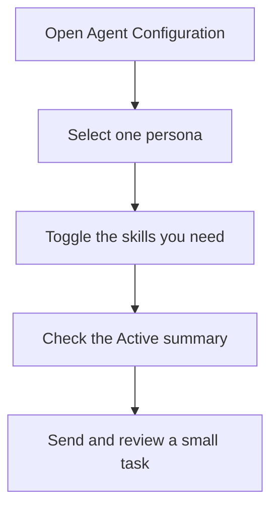

# Personas & Skills

Personas provide a working perspective; skills add reusable practices. These are prompt guidance, not additional tool permissions or guarantees of model behavior.

[Documentation index](README.md) · [Settings reference](SETTINGS.md) · [Provider contracts](NATIVE_APPROVAL.md)

## Personas

Personas change how the AI thinks about your problems. When you select a persona, the AI adopts that role's perspective, priorities, and best practices.

### Built-in Personas

The bundled catalog contains these personas. Open a linked definition to inspect its instructions; the picker also includes eligible user, workspace and imported definitions.

| Persona | Focus |
| --- | --- |
| [Accessibility Advocate](../resources/agents/core/personas/accessibility-advocate.md) | Builds interfaces everyone can use — keyboard-first, screen-reader tested, WCAG 2.2 AA as the floor |
| [Architect](../resources/agents/core/personas/architect.md) | Designs system structure first — boundaries, contracts, and trade-offs before any code is written |
| [Builder](../resources/agents/core/personas/builder.md) | Pragmatic feature-shipper — follows existing patterns, scopes tightly, and delivers complete, tested, review-ready work |
| [Canvas Designer](../resources/agents/core/personas/canvas-designer.md) | Builds real app screens and websites on the Mysti canvas — design systems, device-true layouts, complete states |
| [Code Reviewer](../resources/agents/core/personas/code-reviewer.md) | Staff-level pre-merge review — hunts real bugs, weighs risk, separates must-fix from nice-to-have |
| [Data Engineer](../resources/agents/core/personas/data-engineer.md) | Designs schemas, pipelines, and queries that stay correct and fast as data grows |
| [Debugger](../resources/agents/core/personas/debugger.md) | Root-cause hunter — reproduces, isolates, and fixes bugs with regression tests and a written diagnosis |
| [Designer](../resources/agents/core/personas/designer.md) | UI/UX specialist who ships accessible, consistent, responsive interfaces built on design tokens |
| [DevOps Engineer](../resources/agents/core/personas/devops.md) | Automates deployments, hardens pipelines, and makes infrastructure reproducible and observable |
| [Domain Expert](../resources/agents/core/personas/domain-expert.md) | Models business rules with precision — ubiquitous language, invariants enforced in the domain, edge cases made explicit |
| [Full-Stack Generalist](../resources/agents/core/personas/fullstack.md) | Ships complete features end-to-end — UI, API, data, and deploy — with consistent contracts across every layer |
| [Integrator](../resources/agents/core/personas/integrator.md) | Connects systems, APIs, and services through explicit contracts, resilient adapters, and versioned boundaries |
| [Mentor](../resources/agents/core/personas/mentor.md) | Teaches while solving — explains the why, builds understanding, and levels up the reader with every answer |
| [Performance Tuner](../resources/agents/core/personas/performance.md) | Measures first, then optimizes — profiling, caching, and query tuning backed by before/after numbers |
| [Product-Centric](../resources/agents/core/personas/product-centric.md) | Treats user experience as the north star — every technical choice justified by user impact |
| [Prototyper](../resources/agents/core/personas/prototyper.md) | Ships rough, working proofs of concept fast to answer feasibility questions and surface unknowns early |
| [Refactorer](../resources/agents/core/personas/refactorer.md) | Improves structure, naming, and clarity through safe, incremental, behavior-preserving changes |
| [Researcher](../resources/agents/core/personas/researcher.md) | Attacks hard algorithmic problems with theory, complexity analysis, and rigorous benchmarks |
| [Security-Minded](../resources/agents/core/personas/security.md) | Thinks like an attacker — finds vulnerabilities, models threats, and hardens code before it ships |
| [Toolsmith](../resources/agents/core/personas/toolsmith.md) | Builds CLIs, scripts, and automation that remove friction and multiply the whole team's speed |

### Selecting a Persona

1. Open **Agent Configuration** in the chat header, or use the persona item in the composer's tools menu.
2. Select one persona card. The **Active** summary and persona indicator show your selection. Selecting the same card again clears it.
3. Send a small request such as `Explain this function and suggest one useful test.` Review whether the response follows the chosen perspective.
4. Use **Reset to default** to clear the persona and skill selection together, or clear only the persona with its clear control.

Selections belong to the current conversation and are saved through its agent configuration. They are not global `settings.json` persona/skill arrays. Auto-suggestions can offer a relevant persona when `mysti.agents.autoSuggest` is enabled; the user still chooses what to apply.

### How Personas Work

When a persona is active, Mysti injects role-specific instructions into the prompt:

1. **Key Characteristics**: Defines the persona's approach and mindset
2. **Priorities**: Ordered list of what the persona values most
3. **Best Practices**: Specific techniques the persona follows
4. **Anti-Patterns**: What the persona avoids

## Skills

Skills are toggleable behavioral modifiers that can be combined with any persona.

### Built-in Skills

| Skill | Intended practice |
| --- | --- |
| [API Design First](../resources/agents/core/skills/api-design-first.md) | Designs and states the API contract before implementation — shapes, errors, naming, versioning |
| [Auto-Commit](../resources/agents/core/skills/auto-commit.md) | Commits work incrementally on a feature branch with atomic, conventional commit messages |
| [Auto-Compact](../resources/agents/core/skills/auto-compact.md) | Proactively condenses conversation context at natural milestones, preserving decisions and losing noise |
| [Canvas Design Workflow](../resources/agents/core/skills/canvas-design.md) | Builds app screens and websites through the canvas tools with a render-and-critique pass |
| [Concise](../resources/agents/core/skills/concise.md) | Answers first in minimum words — no filler, no hedging, no restating the question |
| [Dependency Aware](../resources/agents/core/skills/dependency-aware.md) | Vets every new dependency, reuses what the project already has, and keeps versions and lockfiles consistent |
| [Doc Reflexes](../resources/agents/core/skills/doc-reflexes.md) | Documents the "why" behind non-obvious decisions, API changes, and setup steps as you code |
| [First Principles](../resources/agents/core/skills/first-principles.md) | Reasons from fundamental constraints instead of copying familiar patterns |
| [Graceful Degradation](../resources/agents/core/skills/graceful-degradation.md) | Designs code that survives failures — fallbacks, partial results, and clear degraded-state behavior |
| [Observability](../resources/agents/core/skills/observability.md) | Builds meaningful logging, metrics, and error reporting into code as it is written |
| [Organized](../resources/agents/core/skills/organized.md) | Keeps changes cleanly scoped — one concern per commit, clear module boundaries, logical ordering |
| [Repo Hygiene](../resources/agents/core/skills/repo-hygiene.md) | Keeps the repo clean — consistent structure, no dead code, tidy dependencies, correct ignores |
| [Rollback Ready](../resources/agents/core/skills/rollback-ready.md) | Structures every change so it can be reversed in minutes — atomic commits, flags, and compatible migrations |
| [Scope Discipline](../resources/agents/core/skills/scope-discipline.md) | Delivers exactly what was asked — surfaces adjacent work as options instead of silently expanding the change |
| [Secure Coding](../resources/agents/core/skills/secure-coding.md) | Applies a lightweight security pass to every change — validate inputs, protect secrets, least privilege by default |
| [Test-Driven](../resources/agents/core/skills/test-driven.md) | Drives every change with tests — write the failing test first, then make it pass |

### Enabling Skills

Open **Agent Configuration → Skills**, then toggle the practices you want. Multiple skills can be active. The **Active** summary reports the count; toggling a selected skill again removes it. For example, choose **Architect** plus **Concise**, then ask for a short design review.

The selection is stored with the conversation. Enabling Auto-Commit or another practice does not grant command execution, override provider access modes, or replace your project instructions. Inspect an imported skill's instructions and provenance before using it.



[Watch settings and help](DEMO_GALLERY.md#settings-and-help) for the surrounding interface.

## Three-Tier Agent Loading System

Mysti uses a progressive loading system for agent definitions (both personas and skills) to keep the UI fast while supporting rich content.

### Loading Tiers

| Tier | What Loads | When | Purpose |
|------|-----------|------|---------|
| **Tier 1: Metadata** | ID, name, description, icon, category | Always | Fast UI display (lists, dropdowns) |
| **Tier 2: Instructions** | Key characteristics, priorities, practices | On selection | Prompt injection for active persona |
| **Tier 3: Full** | Complete content including code examples | On demand | Deep reference material |

The picker uses metadata without loading every full instruction file. Larger instruction content is loaded on demand; this describes the loading design, not a latency guarantee.

## Creating Custom Personas

You can create your own personas using markdown files with YAML frontmatter.

### File Locations (Priority Order)

| Location | Scope | Priority |
|----------|-------|----------|
| `.mysti/agents/personas/` | Workspace (project-specific) | Highest |
| `~/.mysti/agents/personas/` | User (all projects) | Medium |
| `resources/agents/plugins/personas/` | Imported in a development build | Below user, above core |
| `resources/agents/core/personas/` | Core (bundled with Mysti) | Lowest |

Higher-priority definitions can replace a lower-priority ID in the catalog. Workspace/user/imported content remains untrusted reference material; replacing a bundled ID does not inherit the bundled definition's trust. The UI exposes source/trust metadata.

After creating or editing a definition, run **Mysti: Reload Agents (Personas, Skills & Roles)** if the picker has not refreshed, then inspect and select the new entry. You can also start with **Mysti: Create New Persona** or **Mysti: Create New Skill**.

### Persona Format

Create a markdown file (e.g., `my-persona.md`):

```markdown
---
id: my-persona
name: My Custom Persona
description: Brief description shown in the UI
icon: 🎯
category: general
activationTriggers:
  - keyword1
  - keyword2
---

## Key Characteristics

Describe the persona's approach, mindset, and style.

## Priorities

1. First priority
2. Second priority
3. Third priority

## Best Practices

- Practice one
- Practice two
- Practice three

## Anti-Patterns to Avoid

- Don't do this
- Avoid that
```

### Frontmatter Fields

| Field | Required | Description |
|-------|----------|-------------|
| `id` | Yes | Unique identifier (used in settings) |
| `name` | Yes | Display name in the UI |
| `description` | Yes | Brief description for Tier 1 display |
| `icon` | No | Emoji icon for the UI |
| `category` | No | Category for grouping (general, frontend, backend, etc.) |
| `activationTriggers` | No | Keywords that trigger auto-suggestion |

## Creating Custom Skills

Skills follow the same format as personas but are placed in the `skills/` subdirectory.

### File Locations

| Location | Scope | Priority |
|----------|-------|----------|
| `.mysti/agents/skills/` | Workspace | Highest |
| `~/.mysti/agents/skills/` | User | Medium |
| `resources/agents/plugins/skills/` | Imported in a development build | Below user, above core |
| `resources/agents/core/skills/` | Core | Lowest |

### Skill Format

```markdown
---
id: my-skill
name: My Custom Skill
description: What this skill does
icon: 🔧
category: workflow
---

## Instructions

Describe the behavioral modification this skill applies.

## Rules

1. Always do X
2. Never do Y
3. Prefer Z over W
```

The loader also discovers workspace `.agents/skills/<name>/SKILL.md` and `.claude/skills/<name>/SKILL.md` definitions. These remain workspace reference material. Mysti-native `.mysti/agents` definitions take precedence for matching workspace IDs.

## Syncing Community Agents

For repository contributors, the following development scripts fetch community definitions into the extension source tree:

```bash
# Sync community agents (cached for 24 hours)
npm run sync-agents

# Force sync (bypass cache)
npm run sync-agents:force
```

Synced agents are stored in `resources/agents/plugins/` and load alongside core agents. Installed-extension users can use **Import** in Agent Configuration or **Mysti: Import Skills from GitHub** instead. Importing reference text does not confer authority; review its content and origin.

## Configuration

Persona/skill selection is conversation state. These manifest settings control suggestions and context budget; [SETTINGS.md](SETTINGS.md) lists their current defaults and the separate per-provider persona settings.

| Setting | Default | Description |
|---------|---------|-------------|
| `mysti.agents.autoSuggest` | `true` | Auto-suggest personas based on message content |
| `mysti.agents.maxTokenBudget` | `0` | Max tokens for agent context (0 = unlimited) |

## Tips

1. **Combine personas with skills** for targeted behavior — e.g., Architect + Concise for quick design feedback
2. **Use auto-suggest** to discover relevant personas naturally
3. **Create project-specific personas** in `.mysti/agents/personas/` for domain-specific expertise
4. **Share personas across teams** by committing `.mysti/agents/` to your repo
5. **Token budget**: Set `maxTokenBudget` if agent context is making prompts too long

## Implementation references

[Catalog loading and precedence](../src/managers/AgentLoader.ts), [trusted versus reference prompt routing](../src/managers/AgentContextManager.ts), [conversation persistence](../src/managers/ConversationManager.ts), and [chat controls](../media/chat/index.html) define the behavior described here.
