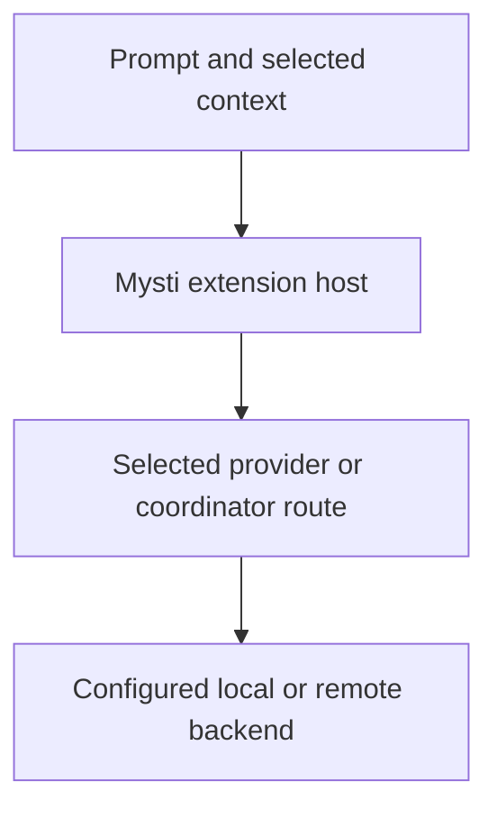

# Privacy, data and account controls

[Documentation index](README.md) · [Provider setup](PROVIDERS.md) · [Backup and recovery](BACKUP-AND-RECOVERY.md)

**Mysti's data flow depends on the provider and features you choose.** A local model can keep that model request local, but it does not make every connected feature offline. This guide describes the **2.0.1 Beta 2** extension's behavior. Provider and DeepMyst backend retention terms are separate from the local extension's implementation.

## Where your information goes



This shows the primary request path. The table below details each route, delegated requests, local storage, optional connected tools and visual features, and telemetry.

| Feature or route | Data involved | Destination / control |
| --- | --- | --- |
| A normal provider request | Prompt, relevant conversation, supplied file/context text and supported attachments | The selected CLI's backend or configured HTTP endpoint. Review the context and selected provider before sending. |
| Multi-agent assignments or Brainstorm | The task and context needed by participants; dependent assignments can receive the earlier result | Each participating provider. Adding a second provider can send information to another service/account. |
| Ollama / LocalAI | The request and supported model input | `mysti.ollamaEndpoint` / `mysti.localaiEndpoint`. Defaults use localhost, but a custom endpoint can be remote. A local server can itself use remote model infrastructure. |
| Mysti coordinator | Prompt, context, selected memories and permitted tool results | DeepMyst gateway, or direct OpenRouter when configured. Delegated work also reaches its selected provider. |
| Canvas generation and visual observation | Generation prompts/assets, inspected DOM/accessibility information, console/network summaries and potentially screenshots | The configured generation service and/or the model receiving the observation. A screenshot can contain private application data. Review the application and feature configuration first. |
| Connected tools | Tool arguments, service responses and account-linked connection metadata | DeepMyst's broker and the selected connected service. Use only the connections needed for the task. |
| Proactive | Selected local repository activity or connected-source evidence | Local Git monitoring runs in the editor; cloud watches use DeepMyst and the connected source. See [Proactive scope](PROACTIVE.md). |
| Export, copy or share | The selected conversation or message, including supported metadata | Your chosen file/clipboard, or an encoded share link. The recipient can read what you share; inspect the contents first. |

Opening a local-model chat does not disable telemetry, model-catalog requests, account services, connected tools or other configured network features. Do not treat provider labels such as “local” as a blanket guarantee about the entire extension.

## Credentials and settings

| Credential | Current storage / source | What to do |
| --- | --- | --- |
| DeepMyst key | VS Code SecretStorage (`mysti.deepmyst.apiKey`) | Use **Mysti: Sign in to DeepMyst** and **Mysti: Sign out of DeepMyst**. Sign-out removes the locally stored key; it does not delete the remote account. |
| MiniMax key | VS Code SecretStorage through provider setup, with `MINIMAX_API_KEY` fallback | Use provider setup to configure it. Revoke/rotate it at the provider when needed; removing one source does not remove an environment-variable fallback. |
| OpenCode remote password | Endpoint-specific VS Code SecretStorage | Use the remote connection setup; credentials for different endpoints are separate. |
| Canvas generation keys | VS Code SecretStorage | Use the Canvas configuration controls. Legacy user-scoped key settings migrate to SecretStorage and are cleared; workspace-scoped legacy key values are not adopted. |
| OpenRouter key | Machine-scoped `mysti.openrouter.apiKey`, then `OPENROUTER_API_KEY` fallback | A settings value is plaintext configuration, not SecretStorage. Keep it out of shared settings/exports; remove the configured source and revoke it at the provider when required. |
| LocalAI key | Machine-scoped `mysti.localaiApiKey` | Treat the settings file and its backups as sensitive. Whether the endpoint needs a key depends on the server. |
| External CLI sign-in | The CLI's own account/configuration store | Use that CLI's account controls. Mysti sign-out does not sign out external CLIs. |

**“Use in local CLIs” changes credential storage.** When enabled in DeepMyst Connections, Mysti writes a `deepmyst-*` MCP broker entry, including a DeepMyst authorization header, into supported CLI configuration files. Depending on the adapter, these include user configuration files, Cline's extension storage, and Claude Code's workspace `.mcp.json`. Workspace writes are guarded against putting credentials into tracked files. Nevertheless, those generated files and their backups contain credentials: do not publish them.

Turn **Use in local CLIs** off or sign out to request removal of Mysti-managed entries. Inspect the Connections status for write/removal errors. Other manually configured MCP servers and provider credentials are separate. A failed cleanup is not proof that every local credential copy disappeared.

VS Code's [`SecretStorage` API](https://code.visualstudio.com/api/references/vscode-api#SecretStorage) manages secret values separately from ordinary extension state. Do not copy a credential store between machines or assume a user-data backup transfers OS-bound secrets. Reauthentication is the safer recovery plan.

## Telemetry controls and current scope

Mysti uses `@vscode/extension-telemetry` with Azure Application Insights. It initializes its reporter when VS Code reports telemetry enabled. To opt out:

1. Open **Preferences: Open User Settings (JSON)**.
2. Set the following VS Code setting, or choose **Off** for **Telemetry: Telemetry Level** in Settings:

```json
{
  "telemetry.telemetryLevel": "off"
}
```

3. Save your work and run **Developer: Reload Window** so Mysti's activation-time telemetry state is refreshed.

VS Code documents this control in its [telemetry guide](https://code.visualstudio.com/docs/configure/telemetry). It does not disable requests you send to providers or connected services, and it does not control a third-party CLI's own telemetry.

Current wired events include extension activation/version, selected account/deep-link and recommendation actions, and aggregate performance timings. **The CodeLens click event also sends the selected function's name.** That name is a code identifier and can be sensitive; this release should not be described as collecting only anonymous counts or no code-related identifiers. The telemetry manager also defines helpers for provider/model and feature identifiers; call-site changes require a privacy review.

Local diagnostic console logs are separate from telemetry. Turning telemetry off does not erase logs or stop all diagnostics. Review logs before sharing them; see [Collect useful logs](TROUBLESHOOTING.md#collect-useful-logs).

## Local storage and retention

[The storage inventory](BACKUP-AND-RECOVERY.md#where-data-lives) identifies conversation state, Canvas files, compaction history, memories, checkpoints and visual screenshots.

- Conversations remain in extension state until removed; the current conversation store has no general time-based expiry. Large tool fields can be truncated for storage.
- Checkpoints have a configurable count limit: `mysti.checkpoints.maxSnapshots` defaults to **200**; **0** means unlimited. They are not a guarantee that every project file is backed up.
- Compaction history can contain full tool output under the workspace's `.mysti/` directory. Do not assume Git ignore rules cover every copy, archive or backup of it.
- The Visual Test dashboard keeps a bounded in-memory observation list per panel; screenshot files are stored separately. Closing a dashboard is not a promise to erase every screenshot file.
- Exported files, clipboard contents, OS/editor logs and external CLI histories have their own lifetimes. Deleting a Mysti conversation does not erase copies outside its conversation store.
- The extension's source does not establish a fixed retention period for DeepMyst, model vendors or connected services. Check the service's account/privacy controls and ask its operator about retention, deletion and access requirements.

## Review, disconnect or remove data

| What you want to remove or stop | Available action | What remains separate |
| --- | --- | --- |
| A saved conversation | Open **History** and use that row's **Delete** action. Export it first if you need it; deletion is immediate. | Exports, provider-side history, checkpoints, compaction files, recovery copies, memories and backups are not an automatic erasure set. |
| An unwanted coordinator memory | Run **Mysti: View & Prune Mysti Memory**, inspect the facts and remove the relevant entry. | This is the coordinator's workspace memory, not every autonomous/project/provider memory store. |
| Future coordinator memory use | Set `mysti.mysti.memory` to `false`. | Existing stored memories are not thereby erased. |
| DeepMyst access from this installation | Turn off **Use in local CLIs**, inspect cleanup status, then **Mysti: Sign out of DeepMyst**. | Remote account data and other installations still need their own account actions. |
| A connected service | Use **Disconnect** in **Mysti: Open DeepMyst Connections**, confirm, and check the result; follow the web management fallback if shown. | The service may retain data already processed, and separate direct integrations can still exist. |
| A provider API key | Remove its configured setting/environment source or use the appropriate setup control, then revoke/rotate it at the provider. | A key may still exist in backups, another profile, a CLI configuration, or another machine. MiniMax has no general sign-out/delete-all-credentials button in this UI. |
| Local files such as screenshots or retained workspace artifacts | Stop work, make any needed backup, close the relevant editor host, and review the specific directory in the storage inventory before removing selected files. | Do not delete the shared VS Code state database or all of `.mysti/` to remove one category. |

There is no single **Erase all Mysti data everywhere** action. Uninstalling the extension should not be treated as verified deletion of workspace files, provider histories, remote account data, or backups. For a complete removal request, inventory the relevant locations and service accounts first. Keep state that is needed for recovery separate from anything you intentionally delete.

## Before sharing an issue or conversation

Review the actual exported text/JSON, screenshot, recording or log excerpt. Remove keys, authorization headers, account identifiers, private prompts, sensitive file paths and source content that the recipient should not receive. Share links encode transcript text; they are not a private authorization boundary. A “sample data” recording should contain synthetic data throughout.

For credential exposure or a permission-boundary problem, use [private security reporting](../.github/SECURITY.md). The published [production-readiness report](PRODUCTION_READINESS.md) describes remaining privacy, permission and native-provider acceptance work.

## Source and scope

This guide is based on [TelemetryManager](../src/managers/TelemetryManager.ts) and its [activation/CodeLens call sites](../src/extension.ts), [DeepMystAuthManager](../src/managers/DeepMystAuthManager.ts), [MCP configuration writes](../src/services/McpConfigManager.ts), [ConnectionsPanelManager](../src/managers/ConnectionsPanelManager.ts), [CanvasSecrets](../src/services/CanvasSecrets.ts), [MiniMaxProvider](../src/providers/minimax/MiniMaxProvider.ts), [OpenCodeRemote](../src/providers/opencode/OpenCodeRemote.ts), [ConversationManager](../src/managers/ConversationManager.ts) and [VisualSessionManager](../src/managers/VisualSessionManager.ts). Settings and defaults are listed in [the generated settings reference](SETTINGS.md).
