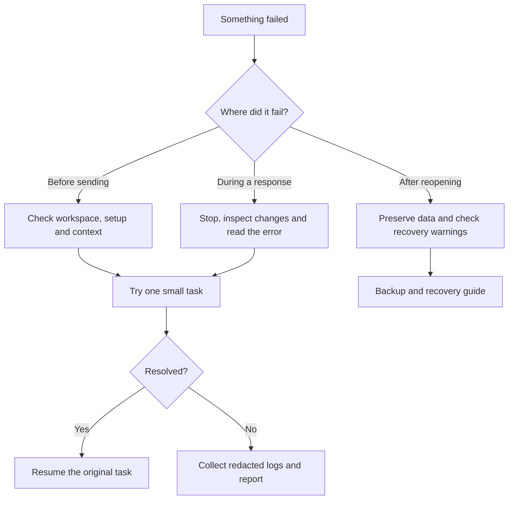

# Troubleshooting Mysti

[Documentation index](README.md) · [Getting started](GETTING-STARTED.md) · [Settings reference](SETTINGS.md)

Use this guide when setup, a response, a visual workflow, or saved history does not behave as expected. Checked against **2.0.1 Beta 2**. A provider being installed, signed in, entitled to a model, and able to run a particular action are separate conditions.

## Start with a small diagnosis

1. **Stop the current response** before retrying a task that may change files. Inspect your working tree for changes already made.
2. Record the exact error and time, Mysti version, VS Code version, OS, selected provider/model, and whether this is a local or remote extension host.
3. Follow the matching row below. Change one setting at a time, then try one small task such as “Reply with one sentence; do not use tools.”
4. If the error persists, collect the relevant logs and [report a reproducible issue](#report-a-reproducible-issue). Repeating a rejected account or model request does not repair its prerequisites.



## Find your symptom

| What you see | Check next | What success looks like |
| --- | --- | --- |
| Mysti is missing or the panel is blank | Confirm the extension is enabled in the active VS Code profile and installed on the intended extension host. Run **Mysti: Open Chat**. Check extension-host logs before reloading. | The chat composer and provider picker appear. |
| The workspace is restricted | Open the intended local project and review VS Code's Workspace Trust decision. Do not enable trust for a project you do not trust. | The permitted setup/workflow controls become available. |
| “CLI not found,” or the wrong CLI version | Follow [CLI path and version checks](#cli-path-and-version-checks). | Mysti's setup card identifies the intended executable and version. |
| Installed, but authentication fails | Use that provider's setup/sign-in action. A DeepMyst sign-in does not sign in every external CLI. | A small request succeeds with the intended provider account. |
| Model not found, forbidden, or quota exhausted | Select a model your account can use; inspect the provider's quota/entitlement response. Follow an offered CLI upgrade only when the error requires one. | The selected model responds without a fallback being mistaken for it. |
| Endpoint, connection, certificate, or proxy error | Follow [network and endpoint checks](#network-and-endpoint-checks). | Discovery/model listing and then a small request succeed. |
| A permission or mode is unsupported | Read [provider compatibility](PROVIDERS.md#permissions-and-compatibility). Choose a supported mode deliberately. Do not grant Full Access merely to dismiss an error. | The requested mode is supported, or the draft remains unsent with a clear explanation. |
| Only one collaborator answers | Inspect each assignment card. Resolve the failed participant's setup first. A dependent “then” step waits for a successful prerequisite. | Each requested agent has an attributed result or an explicit failure. |
| A response stopped but files changed | Stop prevents further work; it does not undo completed edits. Review Source Control, then use the [checkpoint walkthrough](walkthroughs/history-and-checkpoints.md) if an applicable checkpoint exists. | You know which changes remain before sending another task. |
| An attachment is still loading | Wait for its preview or remove it. Check the displayed file-read error, size and path. Explicit collaborator assignments should use Context for files. | The composer can send, and the intended context is visible. |
| A visual report is empty or a browser is missing | Check the [visual browser prerequisites](#visual-browser-prerequisites) and [Visual Test walkthrough](walkthroughs/visual-test.md). Opening the dashboard alone does not create an observation. | A new observation appears for the correct panel and application. |
| History is missing or saving is disabled | Keep the warning text and follow [backup and recovery](BACKUP-AND-RECOVERY.md#when-history-cannot-be-loaded-or-saved). Do not delete the storage database. | Saved history is restored, or the original data is preserved for recovery. |

## CLI path and version checks

Use the executable name from your provider's setup card. For example, Claude Code uses `claude`:

**macOS / Linux**

```sh
command -v claude
claude --version
```

**Windows PowerShell**

```powershell
where.exe claude
claude --version
```

`where.exe` may return several installations. Compare these paths and versions with the executable Mysti reports; a terminal and a GUI-launched editor can inherit different environments. Check the provider's path override in **User Settings**, for example `mysti.claudeCodePath`. Use [the settings reference](SETTINGS.md) for the exact key; endpoint providers such as Ollama and LocalAI use endpoint settings instead of CLI path settings.

If an explicit override points to an old installation, correct it to the intended executable or reset the override to its declared default. After installing/updating a CLI or changing the environment, save your work and fully restart VS Code, then refresh provider detection. Do not remove every CLI installation as a first troubleshooting step.

**Expected result:** terminal and setup card agree on the intended version. Authentication and a first real request still need their own checks.

## Network and endpoint checks

- For Ollama or LocalAI, check `mysti.ollamaEndpoint` or `mysti.localaiEndpoint`, start the intended server, and confirm the requested model is installed there. `localhost` means the machine running the extension host; it may differ from your desktop in a remote session.
- For OpenCode remote mode, use its [remote connection guide](PROVIDERS.md#opencode-in-wsl-docker-or-a-remote-server). Confirm server reachability and the password for that endpoint.
- Preserve the HTTP status and service error text. Authentication failures, account eligibility, quota limits, rate limits and connection failures need different remedies.
- On a managed network, ask the administrator for the supported proxy and certificate configuration for the editor **and** the provider CLI. A browser reaching a site does not prove the CLI uses the same network configuration.
- Do not disable TLS validation or put credentials into screenshots, URLs, issue bodies, or command-line examples. Check for query-string secrets before sharing an endpoint.

## Visual browser prerequisites

Mysti's visual tools use Playwright browsers. The extension currently locks Playwright to **1.58.2**. If the reported error says Chromium is missing and Node/npm is available, install the matching browser for the account and machine running Mysti:

```sh
npx playwright@1.58.2 install chromium
```

For repository development, use the already installed locked dependency:

```sh
npm exec --no -- playwright install chromium
```

Linux can also require system libraries; the installer reports missing dependencies. Use your administrator's approved installation process. A browser installed as another OS user or on the desktop is not necessarily available to a remote extension host. Preserve the exact error if installation fails.

Then check the trusted workspace, configured application URL, permitted origin and any dev-server approval described in the [Visual Test walkthrough](walkthroughs/visual-test.md). Do not enable unrelated tool permissions to solve a missing-browser error.

## Collect useful logs

1. Note the failure time and reproduce once with a small, non-sensitive example.
2. Open **View → Output**, select **Log (Extension Host)**, and look around that time for `Mysti`, the provider name, or the error. Remote windows may have a separate extension-host log; choose the host where Mysti is installed.
3. For a blank or broken webview, run **Developer: Toggle Developer Tools**, open **Console**, and look for `[Mysti Webview]` or the associated error. This complements the extension-host log.
4. For Canvas, search the Command Palette for **Canvas Diagnostics**. Read the notification; the detailed JSON is logged as `[Mysti] canvas diagnostics` in the extension host. Inspect that excerpt before sharing it.
5. When debugging a repository build launched with F5, use the original window's **Debug Console** and filter for `[Mysti]`.

Mysti currently uses extension-host and webview console logging; there is no dedicated **Mysti** Output channel or one-click sanitized support bundle. Logs can contain local paths, model/provider identifiers and other context. Copy only the relevant time window into a separate file. Remove tokens, headers, private prompts, code, account identifiers and sensitive paths before sharing. Do not attach an entire VS Code data directory or unreviewed conversation export.

## Recover an interrupted task

Read the partial answer and inspect files before retrying. A completed tool action may already have changed the project. Start a narrower follow-up in the same conversation when that context is still useful; fork when you want a separate direction.

An **Unsent message** card can restore a rejected/cancelled submission that never reached history. **Restore draft** does not send it automatically. These cards and ordinary unsent drafts are not durable backups: copy important text before closing or reloading the view. Persisted conversation recovery, JSON export and workspace backups are covered in [Backup and recovery](BACKUP-AND-RECOVERY.md).

## Report a reproducible issue

Use the [bug report form](https://github.com/DeepMyst/Mysti/issues/new/choose). Include:

```text
Mysti version / install source / release channel:
VS Code version / OS / architecture / local or remote host:
Provider / CLI version / selected model / access mode:
Steps to reproduce with synthetic data:
Expected result:
Actual result and exact error:
Failure time and relevant redacted log excerpt:
What changed recently and what you already checked:
```

A short recording is useful when it shows the action and result. Avoid sharing credentials or private workspace content. Report security vulnerabilities privately through the [security policy](../.github/SECURITY.md), rather than through a public bug report.

## Source and scope

The commands/settings come from [the extension manifest](../package.json). Relevant implementation: [provider discovery](../src/utils/platform.ts), [conversation transfer and recovery UI](../src/providers/ChatViewProvider.ts), [visual browser management](../src/services/BrowserManager.ts), and [Canvas commands](../src/extension.ts). The [readiness report](PRODUCTION_READINESS.md) distinguishes tested journeys from outstanding native/platform acceptance.
