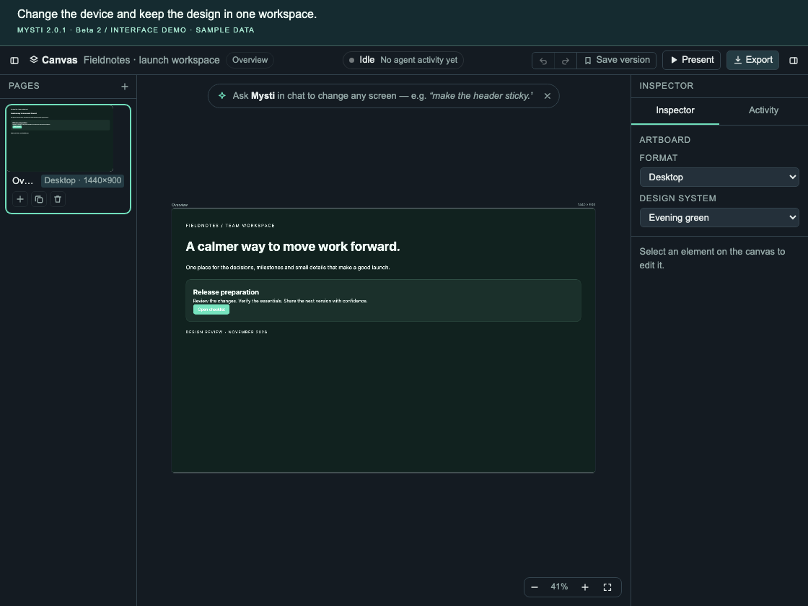
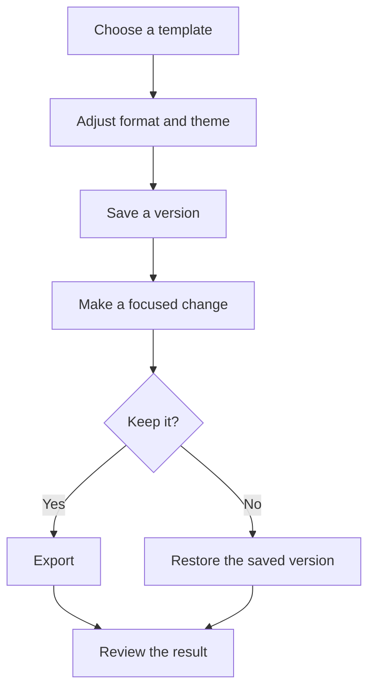

# Build a design in Canvas

**Goal:** start from a template, change its appearance, save a version and export
a design you can open in a browser.

[All walkthroughs](README.md) · [Settings reference](../SETTINGS.md) · [Backup and recovery](../BACKUP-AND-RECOVERY.md)

## Before you start

- Open a local workspace folder in VS Code with Mysti installed.
- Use a folder you can write to; Canvas saves its design under `.mysti/canvas/`.
- Built-in templates and manual edits do not need a model account. Configure a
  provider if you want an agent to change the design later.



*Sample design in the shipped Canvas interface. Your workspace starts empty if
it has no saved design.*

## Create your first page

1. Open the Command Palette and run **Mysti: Open Canvas**.
   **Look for:** the **Design your app or website** empty state, or the most
   recently saved design from this workspace.
2. Choose **Landing page** from the empty-state templates. If a design is already
   open, use **+** beside **Pages** (**Add a page from a template**) and choose
   **Landing page** there.
   **Look for:** a new page thumbnail and a rendered artboard.
3. Select that page in the **Pages** rail. Use **Zoom to fit** at the bottom of
   the board if the whole page is not visible.
   **Look for:** the selected page name near the top and its artboard in view.

This gives you a working starting point before asking a model to generate or
modify anything.

## Change the format and design system

1. Open the **Inspector** tab on the right. On a narrow panel, use **Show the
   inspector** in the top bar to reveal it.
2. Change **Format** to **Mobile**, **Tablet**, **Web** or **Desktop**.
   **Look for:** the selected artboard changing size. This changes the saved
   artboard format; it is not just a temporary browser-device preview.
3. Choose a **Design system** preset.
   **Look for:** the design's shared colors and typography changing. The theme
   applies to the design, so inspect its other pages too.
4. Click an element on the artboard to inspect the controls available for that
   element. Make one small change, then use **Undo** if you want to compare it
   with the previous state. **Redo** reapplies an undone change.

Changing artboard size helps you inspect layout at different dimensions. It does
not establish that your separate application code is responsive; use the
[Visual Test walkthrough](visual-test.md) to inspect a running app.

## Keep a version and ask for a focused change

1. Click **Save version** before a larger experiment.
   **Look for:** a version entry such as **Version 1** in the **Activity** tab's
   timeline. This is a Canvas design version, separate from chat code checkpoints.
2. To involve an agent, open Mysti chat with the Canvas still open, choose a
   configured provider and send a focused request:

   ```text
   On the current Canvas landing page, shorten the headline and make the
   primary call to action clearer. Keep the current layout and colors.
   ```

3. Watch the Canvas status and **Activity** tab. Review any proposed edits or
   approval requests required by your selected access mode.
   **Look for:** the requested change on the artboard, not only an agent message
   saying it was done. Provider/model behavior can differ.
4. To return to the saved design, choose **Restore** on its version entry.
   Canvas restoration is itself an undoable design operation.



## Save and export

Canvas schedules saves automatically after edits; it stores the artifact and
associated assets under `.mysti/canvas/<design-id>/`. After editing, allow the
save to settle, close the Canvas tab and reopen **Mysti: Open Canvas** to confirm
that your design returns. A saved version is not a backup outside this folder.

1. Click **Export** in the top bar.
2. Choose a **new, empty output folder**, then **Export design here**. The export
   writes files into that folder, so use a separate folder from your app source.
3. Wait for **Canvas exported to …**, then choose **Open**, or open the exported
   `index.html` yourself.
4. Inspect every exported page and its images before sharing it.

The current **Export** button produces an HTML bundle with its required runtime
and design assets. It does not publish a website or export a production React
application. PNG/PDF/component-export helpers elsewhere in the repository do
not mean those formats are available through this button.

## Watch the controls

**15 seconds · theme, format and Export**

https://github.com/user-attachments/assets/24cb574f-98d3-4bcf-9d18-f2be7a18e21f

*This sample-data recording shows the real Canvas renderer and controls. Its
host operations are fixtures; it does not write an export file.*

## If something does not work

| What you see | What to do |
| --- | --- |
| An empty Canvas | Check that the intended workspace folder is open. Choose a template if this workspace has no saved design. |
| A warning that the latest design could not load | Preserve `.mysti/canvas/` before experimenting. Mysti reports that the saved file was not modified; follow [backup and recovery](../BACKUP-AND-RECOVERY.md). |
| A blank or failed artboard | Keep the displayed error, try a built-in template to isolate the problem, and collect redacted diagnostics using [troubleshooting](../TROUBLESHOOTING.md). |
| An agent describes a change but the artboard stays the same | Check its errors, access mode and any pending proposal/approval. Retry a smaller request after resolving the reported cause. |
| Export produces no success notification | Check the chosen folder's permissions and diagnostics. Do not assume a partially written folder is a complete export. |

## Source and verification

Checked against Beta 2's [Canvas host and HTML export](../../src/providers/ChatViewProvider.ts),
[Canvas controls](../../src/webview/canvas/app.ts), [version controls](../../src/webview/canvas/historyUi.ts)
and [shipped templates](../../src/managers/CanvasScaffolds.ts).
The [cold-open regression](../../tests/integration/canvasColdOpenJourney.test.ts)
checks template creation, persistence and reopening with a real temporary store.
These source/regression references do not replace native provider acceptance.
