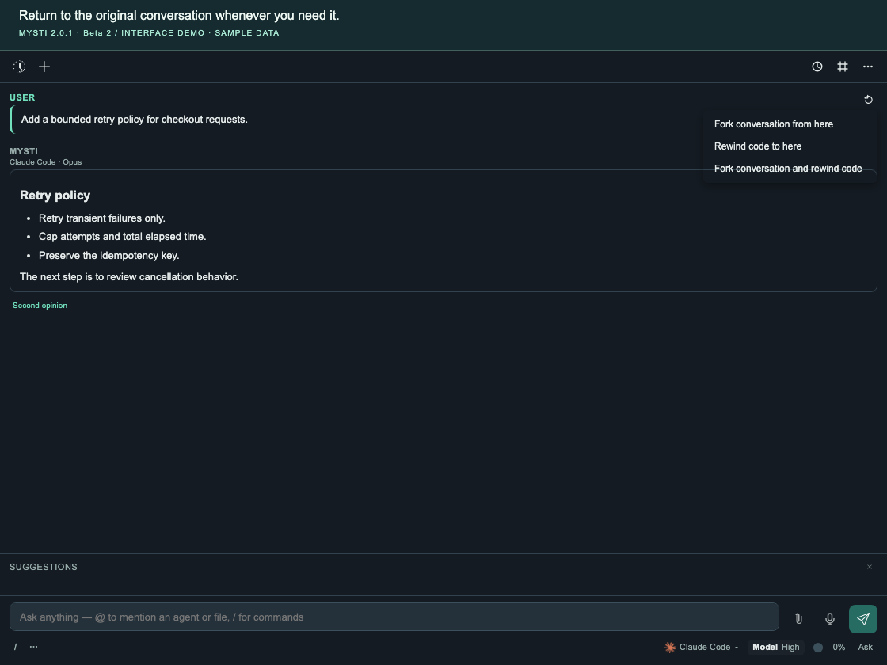
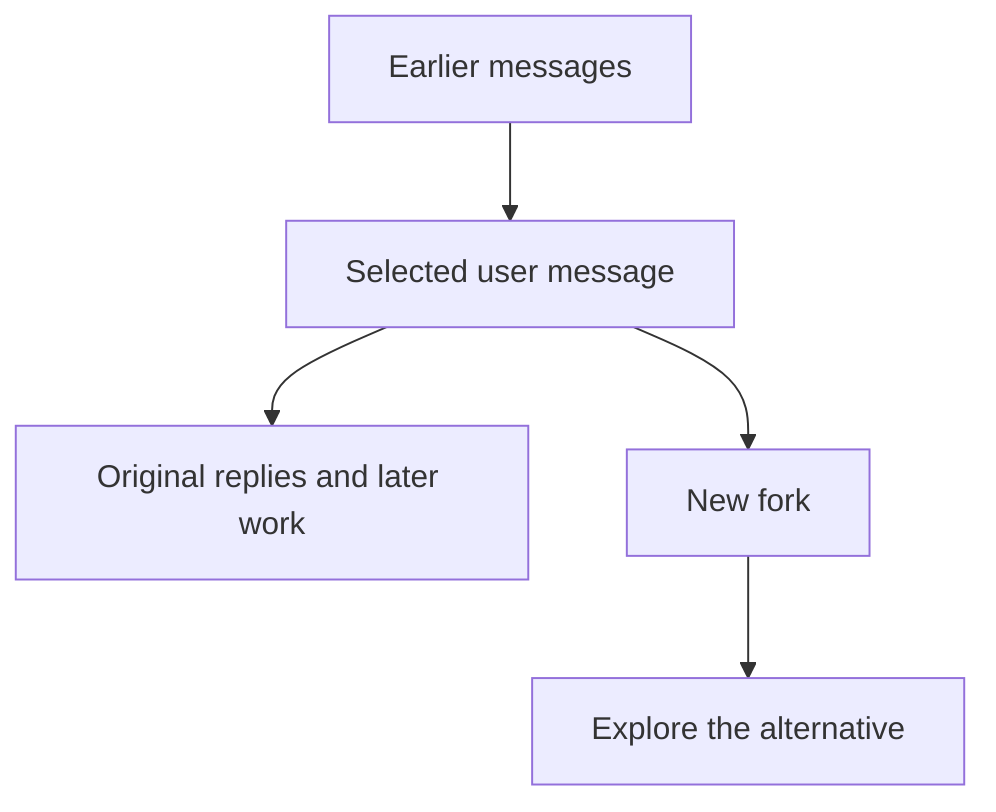

# Revisit, fork or rewind your work

**Goal:** return to an earlier conversation, explore a different idea, or
explicitly restore local code to a checkpoint.

[All walkthroughs](README.md) · [Backup and recovery](../BACKUP-AND-RECOVERY.md) · [Troubleshooting](../TROUBLESHOOTING.md)

## Choose the action that matches your goal

| You want to… | Choose | Effect on workspace files |
| --- | --- | --- |
| Continue an older chat | A conversation in **Chat History** | Opening history does not restore files. |
| Try another line of reasoning | **Fork conversation from here** | Creates a separate chat; files stay as they are. |
| Restore earlier local code | **Rewind code to here** | Restores eligible files from the selected turn's checkpoint after confirmation. |
| Branch the chat and restore its code starting point | **Fork conversation and rewind code** | Rewinds files first; creates the fork only if restoration succeeds. |



*Sample conversation showing the real menu. This screenshot does not demonstrate
a disk restoration.*

## Open an earlier conversation

1. Open Mysti chat and select the clock/history button in its header.
2. Choose the conversation by its title and date.
   **Look for:** its saved messages and selected provider/model.
3. Add current files or selected code through Context before sending a follow-up
   if the workspace has changed since that conversation.

History records what was said. It is not a snapshot of the current filesystem,
and unsent drafts or recovery cards may not survive closing or reloading a view.

## Explore an alternative without changing files

1. Find the **user message** where the alternative should begin.
2. Open its **↶ / rewind** menu and choose **Fork conversation from here**.
   **Look for:** a separate conversation with **(fork)** in its initial title.
   It contains messages through the selected user message; later messages from
   the original conversation are not copied.
3. Send a new direction:

   ```text
   Explore a queue-based alternative to the retry policy. Explain the tradeoffs
   before proposing any code changes.
   ```

4. Use the history menu to return to the original conversation whenever needed.
   Its later messages remain available there.



Both conversations still use the same workspace. If an agent edits files in one
chat, those changes are visible to the other. A conversation fork is not a Git
branch or a separate working directory.

## Rewind local code deliberately

Before trying this, use a disposable project or preserve work you want to keep
through normal version control and [backup](../BACKUP-AND-RECOVERY.md).
Checkpoints need Git available, an open workspace and
`mysti.checkpoints.enabled` enabled.

In a multi-root workspace, checkpoints cover the **first workspace folder**.
Open the intended project on its own if you are unsure which folder that is.

1. Stop agent work against this project, including other editor windows and
   external tools. Mysti refuses a rewind while another chat in the same VS Code
   window is running; it cannot enforce that pause in other windows or tools.
2. Find the user message whose **pre-turn** code state you want to restore.
   Open its rewind menu and choose **Rewind code to here**.
3. Read the confirmation. Rewinding can replace modified files, restore deleted
   files and remove eligible files created after that checkpoint.
4. Choose **Rewind** only when that is the intended result.
   **Look for:** **Code rewound to the selected checkpoint.** Inspect the actual
   files and your normal Git diff before continuing.
5. If this was the wrong point, choose **Undo** in that success notification
   while it is still applicable. Mysti first takes a safety checkpoint and uses
   it for this action. If Undo is unavailable or reports an error, preserve the
   error and follow the recovery guide instead of guessing at storage files.

**Fork conversation and rewind code** follows the same confirmation and file
restoration path, then opens a new conversation branch on success. Use it when
you want both an alternate chat and the earlier code starting point.

Mysti's checkpoints use a private Git repository outside the project. They do
not rewrite your project's Git commits, but a rewind **does change working
files**. It does not undo a deployment, push, database change or other external
side effect.

## When rewind is unavailable

| What you see | Meaning and next step |
| --- | --- |
| **Code checkpoints unavailable (git not found or disabled)** | Check Git availability, the open workspace and `mysti.checkpoints.enabled`. Forking the conversation can still work. |
| **No checkpoint captured for this turn yet** | The snapshot may still be pending, or none was captured. Do not assume an older imported message has a usable checkpoint. |
| **Checkpoint no longer exists** or another restoration error | The snapshot may have been pruned or become unavailable. Preserve the message and use your independent backup/version control. |
| **Another chat is still working** | Stop that chat before changing shared files. |
| A conflict would overwrite a path not backed up by the safety snapshot | Move or back up that path as directed before attempting restoration again. |

Defaults retain **200 checkpoints per workspace** and skip snapshots above
**20,000 files**. Ignored/heavy paths and other exclusions are not a complete
filesystem backup. See [settings](../SETTINGS.md) for
`mysti.checkpoints.maxSnapshots` and `mysti.checkpoints.maxFiles`, and
[backup and recovery](../BACKUP-AND-RECOVERY.md) for storage and migration details.

## Watch the menu

**21 seconds · history, branching and the rewind choices**

https://github.com/user-attachments/assets/daa6adf2-c763-4c8b-9bca-b6d38b9acf5b

*This sample-data demonstration branches displayed history. It does not execute
a workspace rewind or establish backup/restore compatibility.*

## Source and verification

The [chat menu](../../media/chat/chat.js),
[conversation fork implementation](../../src/managers/ConversationManager.ts),
[rewind confirmation and ownership](../../src/providers/ChatViewProvider.ts) and
[checkpoint manager](../../src/managers/CheckpointManager.ts) define the behavior.
Relevant regressions include [fork reliability](../../tests/managers/conversationForkReliability.test.ts),
[checkpoint retention](../../tests/managers/checkpointRetention.test.ts) and
[checkpoint/fork safety](../../tests/managers/checkpointForkSafety.test.ts).
