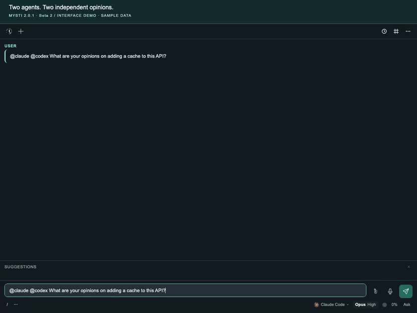
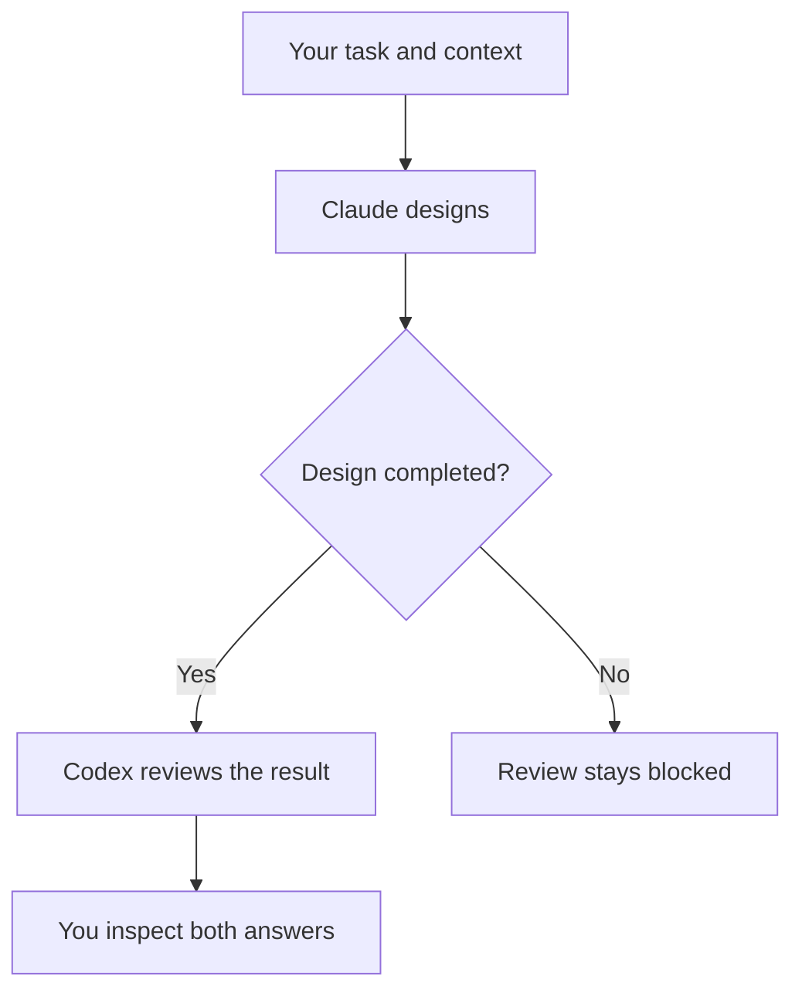
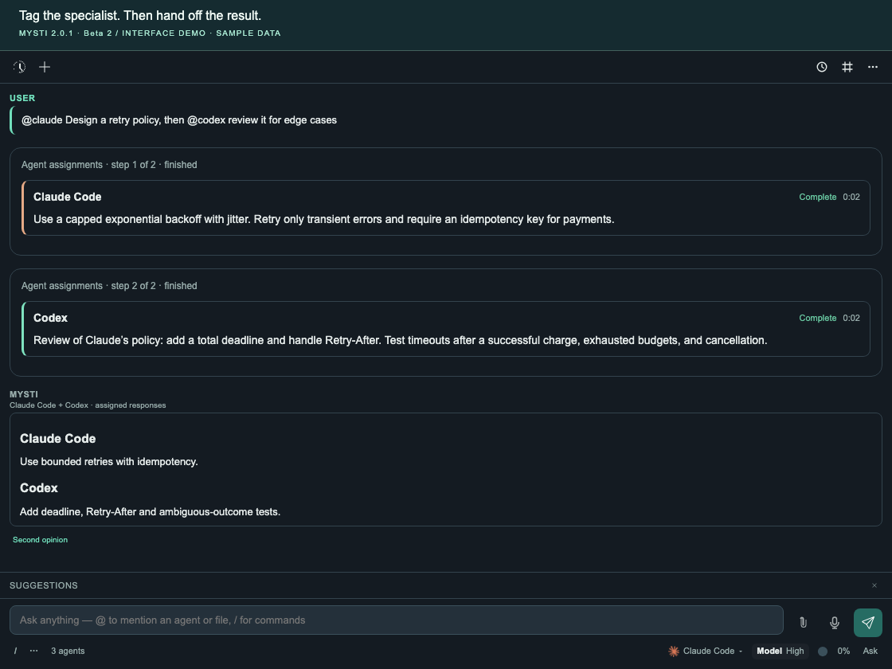

# Work with multiple agents

**Goal:** get two independent opinions, then try a clear design-to-review
handoff without losing who said what.

[All walkthroughs](README.md) · [Provider setup](../PROVIDERS.md) · [Assignment reference](../MENTIONS.md)

## Before you start

- Configure **Claude Code** and **Codex**, including their sign-in and model
  availability. These examples use `@claude` and `@codex`; substitute other
  configured providers using the [supported tags](../MENTIONS.md#provider-tags).
- Open a small project or a focused design document. Use an access mode
  supported by both providers and review any requested actions.
- Add relevant code using **Add to Mysti Context** or select a file mention from
  the composer suggestions. Collaborator dispatch currently does not forward
  composer attachments; use Context or workspace file mentions for these runs.

## Compare two independent opinions

1. Open Mysti chat and add the code or proposal you want reviewed.
2. Send:

   ```text
   @claude @codex What are your opinions on adding a cache to this API?
   Explain the tradeoffs and failure cases separately. Do not edit files.
   ```

3. Watch the two assignment cards.
   **Look for:** a separate provider name, progress and result for each agent.
   Independent advisory work can run concurrently within the collaborator limit.
4. Read both attributed answers. Compare their assumptions and evidence before
   choosing the next step. A failed participant is not replaced with an answer
   invented by the other agent.



*Sample-data interface demonstration. Each provider's answer remains separately
attributed in the completed conversation.*

## Hand a finished result to a reviewer

1. Keep the relevant context attached and send an explicit dependency:

   ```text
   @claude Design a retry policy, then @codex review it for edge cases
   ```

2. Follow the step indicators.
   **Look for:** Claude working first while Codex waits. After Claude finishes,
   Codex receives the completed answer as reference for its review.
3. Read the review alongside the original design. A failed or empty first step
   blocks the dependent review instead of silently continuing without it.





*Sample-data handoff. The cards show the execution order; the final response
preserves both participants' contributions.*

Use the same **then** pattern when the first task changes code:

```text
@claude Implement the agreed retry policy with tests, then @codex review the diff
```

Review the proposed actions and final diff. Work that may write files is
serialized in the shared workspace, and provider permission limits still apply.
The word **then** expresses order; it does not grant editing authority.

## Give each participant a focused role

For two read-only perspectives on the same proposal:

```text
@claude:critic @codex:reviewer Assess this proposal
```

For different questions in one message:

```text
@claude review the authentication design; @codex assess performance
```

Keep the assignment boundaries explicit. Mysti uses conservative routing rules;
this is an in-session workflow, not an arbitrary branching workflow engine.

## Choose the right collaboration shape

| What you need | Use |
| --- | --- |
| Separate answers you can compare yourself | Multiple agent tags in one request |
| Work that must finish before another task starts | **then** before the next agent tag |
| Another view on a completed answer | **Second opinion** below that answer; select another configured provider |
| A configured discussion strategy followed by synthesis | [Brainstorm mode](../BRAINSTORM.md) |

Explicit tags remain assignments even when that provider is already selected
in the composer. The selected provider is not an extra participant unless the
request also assigns work to it.

## Watch the handoff

**17 seconds · one agent designs, the next reviews**

https://github.com/user-attachments/assets/c453b15b-39a0-41c3-98b8-7ad8709a6785

*The recording uses labelled sample responses. For all 15 demonstrations, open
the [demo gallery](../DEMO_GALLERY.md). Native provider acceptance is tracked
separately in [production readiness](../PRODUCTION_READINESS.md).*

## If the workflow stalls

| What you see | What to do |
| --- | --- |
| One agent is unavailable | Resolve that provider's installation, sign-in or model error. Successful peers can still provide their own answers. |
| The reviewer is waiting | Check whether the preceding assignment is still running or failed. A dependency must finish successfully. |
| Both tasks run serially | The planner may classify them as possible writers, or the configured concurrency is limited. Start with the explicit read-only example above. |
| An attachment warning appears | Add the relevant material through Context or a workspace file mention before retrying. |
| You want to stop | Use **Stop**. It cancels the current assignment group and pending steps; it is not a per-participant stop button. |

After a failure, narrow the request and resolve its reported cause before
resending. Include the exact redacted prompt, tags and card states in a support
report; see [troubleshooting](../TROUBLESHOOTING.md).

## Source and verification

The [assignment reference](../MENTIONS.md) explains routing, context and limits.
Implementation lives in [MentionRouter](../../src/managers/MentionRouter.ts),
[CollaboratorPool](../../src/services/CollaboratorPool.ts) and the
[chat host](../../src/providers/ChatViewProvider.ts).
[Live conversation scenarios](../../tests-live/conversations.test.ts) exercise
configured native providers when explicitly run; their presence alone does not
qualify an untested account or model.
