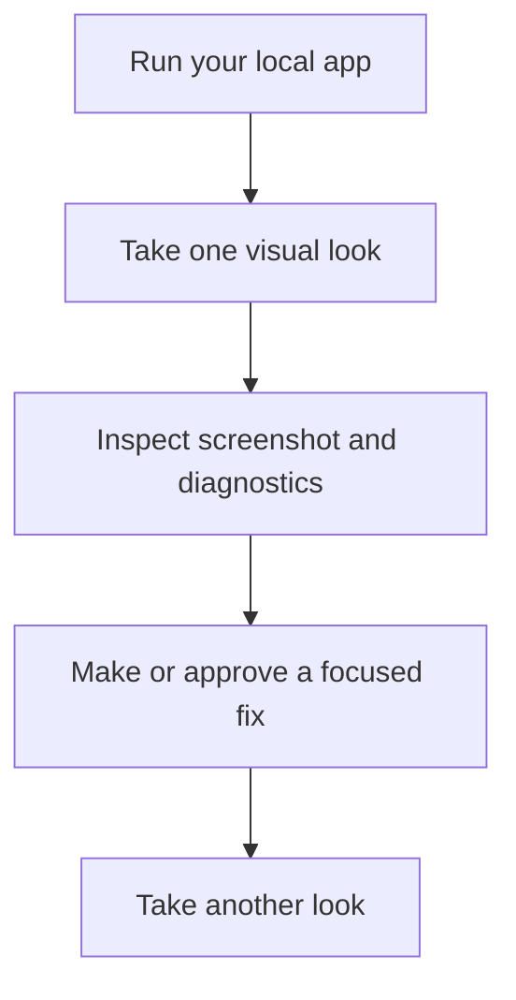
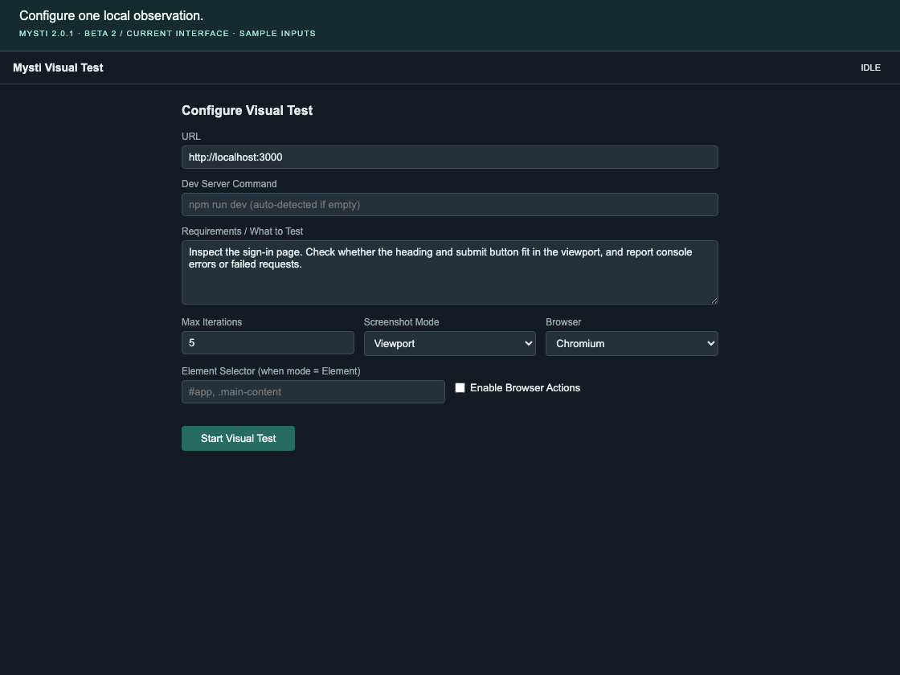

# Take a visual look at your app

**Goal:** capture a running web app, inspect its screenshot and diagnostics, then
use those observations to guide a small fix.

[All walkthroughs](README.md) · [Troubleshooting](../TROUBLESHOOTING.md) · [Privacy and data controls](../PRIVACY.md)

The current Visual Test dashboard takes **one observation**. It does not run an
automatic screenshot/analyze/fix loop. Repairs happen in chat through the
selected agent's normal tools and approvals.



## Before you start

- Open the app's workspace in VS Code. Use a trusted local project whose start
  command you understand.
- Start the app with its documented development command and confirm that its
  local URL opens in your ordinary browser.
- Keep `mysti.visualTest.enabled` enabled. It is enabled by default.
- Install the browser expected by this Mysti release if the diagnostic reports
  it missing. For the installed **2.0.1 Beta 2** extension:

  ```sh
  npx playwright@1.58.2 install chromium
  ```

  For a checkout of this repository after `npm ci`, use its locked dependency:

  ```sh
  npm exec --no -- playwright install chromium
  ```

No model request is needed for the dashboard capture itself. A configured
provider is needed if you later ask an agent to interpret findings or edit code.
Use non-sensitive test data in the app; screenshots can contain everything
visible on the captured page.

## Configure the first observation



*Current shipped form with labelled sample inputs, captured before Start. No
app observation or model request was executed. [Capture provenance](../media/walkthroughs/README.md).*

1. Open the Command Palette and run **Mysti: Open Visual Test Dashboard**.
   **Look for:** the **Configure Visual Test** form.
2. Set **URL** to the exact address of your app, for example
   `http://localhost:3000`. Use its actual port if different.
3. Leave **Dev Server Command** empty when following the already-running-app
   path. If Mysti offers to start a server, inspect the proposed command before
   approving it. An empty field can allow discovery of a `dev`, `start` or
   `serve` script from the workspace's `package.json`.
4. Enter a focused description in **Requirements / What to Test**:

   ```text
   Inspect the sign-in page. Check whether the heading and submit button fit
   in the viewport, and report console errors or failed requests.
   ```

5. Choose **Viewport** in **Screenshot Mode** for your first check. Use **Full
   Page** for a longer page; **Element** also needs an **Element Selector**, such
   as `#sign-in-form`, that actually exists in your app.
6. Clear **Enable Browser Actions** for an observation-only first run, then
   click **Start Visual Test**.
   **Look for:** a screenshot followed by **Look complete**, or a specific
   actionable error.

The requirements text provides focus for the observation. It does not create
executable acceptance assertions for every sentence you wrote.

## Read the result

| Region | What to inspect |
| --- | --- |
| **Screenshot** | The actual page, selected capture area, loading state and visible layout. |
| **Issues** | Reported layout probes or policy denials. Investigate each finding in context. |
| **Action Log** | The URL observed, capture progress, console-error count, failed requests and any error message. |

**Look complete** means an observation finished. An empty issue list does not
prove that the app is accessible, correct or ready for production. Check the
screenshot and run your application's own functional and accessibility tests.

## Make a fix and compare

1. Return to chat and include the relevant source file through Context. Copy the
   important finding or attach the screenshot when your provider supports images.
   The dashboard's complete report is not automatically sent as a chat prompt.
2. Ask for one bounded improvement, for example:

   ```text
   The sign-in heading overflows at 390px width. Review the attached screenshot
   and the selected component. Explain the cause and propose a minimal fix.
   ```

3. Review the proposed change and any required permission request. Inspect the
   actual diff and the running page after the edit.
4. Close the Visual Test tab, reopen it and repeat the same URL, capture mode and
   focus to compare the result. Closing the dashboard releases its owned visual
   session; an app you started independently remains under your control.

For a mobile-size capture, set these in **VS Code User Settings**, then open a
fresh dashboard session:

```json
{
  "mysti.visualTest.viewportWidth": 390,
  "mysti.visualTest.viewportHeight": 844,
  "mysti.visualTest.browser": "chromium"
}
```

## Controls and boundaries in this beta

- **Max Iterations** is still visible in the form, but the current host takes
  one observation. Increasing it does not enable automatic repairs.
- The form's **Browser** selection is not forwarded by the current host handler.
  Set `mysti.visualTest.browser` in VS Code settings and install that browser.
- Manual dashboard capture and agent-driven visual tools are separate. Agent
  observation requires the user-controlled `mysti.mysti.visualTools` setting to
  be `on`, plus a trusted workspace. Leave it off if you only need manual checks.
- Allowed origins default to loopback addresses. A blocked origin is a policy
  decision; use the intended local app URL and do not broaden the allowlist to
  work around an unexplained failure.
- Browser observations may include app data, DOM text and screenshots. Review
  what you share with a provider; see [privacy](../PRIVACY.md).

## Watch the layout

**15 seconds · screenshot, findings and action log**

https://github.com/user-attachments/assets/c1c6aefa-fe50-4d76-aa56-243e2a010a1e

*This labelled sample report explains the display. It is not a live provider
test or proof of an automatic fix loop.*

## If something does not work

| Symptom | Next step |
| --- | --- |
| Clicking Start does nothing | Fill **Requirements / What to Test**; the form requires non-empty text. |
| Browser is missing | Run the pinned installation command above for the configured browser. A missing Playwright module instead calls for reinstalling the extension. |
| URL is unavailable | Verify the app and port in an ordinary browser; inspect its terminal output. |
| A selector cannot be found | Start with **Viewport** capture, then use a selector that exists after the page finishes loading. |
| An error remains on the result screen | Keep its text, correct the cause, then close and reopen the dashboard for a fresh attempt. |

## Source and verification

The [dashboard form](../../media/vt-dashboard/index.html),
[result renderer](../../media/vt-dashboard/vt-dashboard.js),
[host's `_runDashboardLook`](../../src/providers/ChatViewProvider.ts) and
[visual policy resolver](../../src/services/visualTestPolicy.ts) define these steps.
[Policy tests](../../tests/services/visualTestPolicy.test.ts) and
[visual-manager tests](../../tests/managers/visualTestManager.test.ts) cover the
underlying boundaries. Native application/provider acceptance remains separate.
